# GlitchBoard

GlitchBoardは、複数のProjectをひとつの画面で見渡せるVS Code拡張機能である。\
作業を **Project → Event → Story → Task** の順に整理し、期限と進み具合を確認できる。\
データは`manage.yaml`とProjectごとのYAMLファイルに保存する。

## 使い始める

1. VS Codeのアクティビティバーで **GlitchBoard** を開く。\
   サイドバーに「EVENT一覧」が表示される。
2. 初回は **「manage.yamlを選ぶ」** で既存の管理ファイルを指定するか、**「新しく作る」** で作成する。\
   VS Codeの設定`glitchboard.manageFile`に`manage.yaml`の絶対パスを指定することもできる。\
   設定先にファイルがない場合も、ボードとEVENT一覧に表示されるボタンから新規作成または別のファイルの選択へ進める。
3. コマンドパレットで **「GlitchBoardを開く」** を実行すると、エディタにボードが開く。
4. ボードでProjectを追加し、その中にEvent、Story、Taskを作成する。

管理ファイルは、現在VS Codeで開いている作業フォルダとは別の場所に置ける。\
空の管理ファイルを手で作る場合は、次の内容から始められる。

```yaml
settings:
  workdays_off: [sat, sun]
  public_holidays: true
projects: []
```

Projectを追加すると`projects/0001_名前.yaml`のようなファイルが作られ、その相対パスが`manage.yaml`に記録される。

## ボードの見方

画面例にはダークテーマと、2026年11月6日時点で実績ペースの学習が終わった[サンプルデータ](examples/readme-demo/manage.yaml)を使用している。\
左側にEVENT一覧、右側のボード上段に期間の指標とタイムライン、下段に選択したEventの詳細、Story一覧、Task一覧が並ぶ。

タイムラインと下段の高さは、間の境界を上下にドラッグして調整できる。\
初期比率は上段と下段が3対2で、境界をダブルクリックすると元に戻る。\
境界にフォーカスを置いて上下キーでも調整でき、Homeキーで初期比率に戻せる。\
Projectの通常行は44pxで、件数が多い場合はタイムライン内をスクロールする。

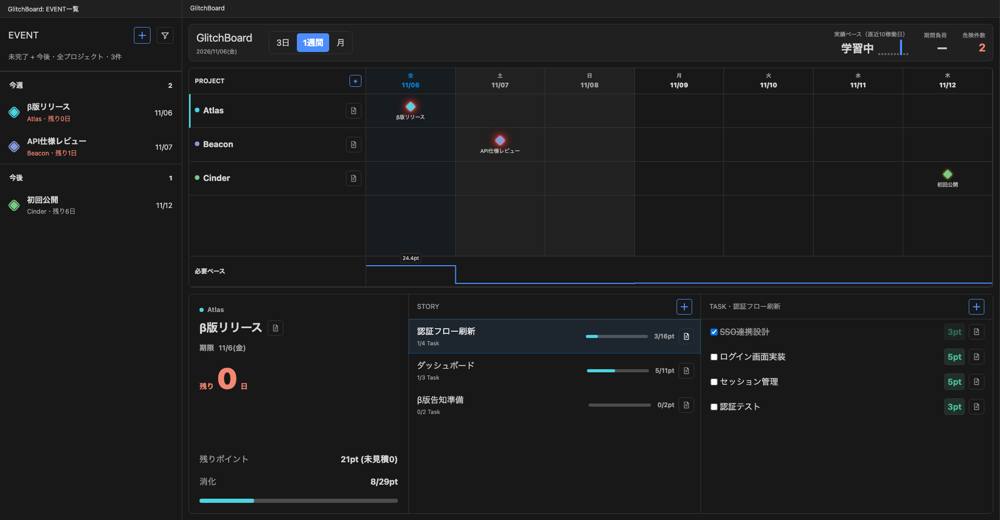

### 期間と指標

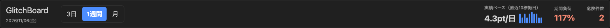

**3日・1週間・月** を切り替えて、見たい期間の予定を確認できる。\
実績ペース、期間負荷、危険件数などは、現在の作業量と期限を把握するための目安となる。\
画面例では直近10稼働日の実績ペースが4.3pt/日、表示期間の負荷が117%である。

### Projectとタイムライン

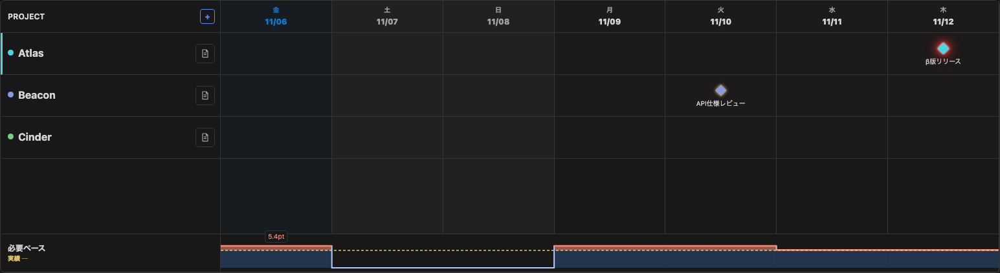

左のPROJECT列にはProjectが並び、横方向にはEventの期限が◆で表示される。\
期限切れのEventは専用の列でも確認できる。\
最下段の必要ペースは青い面と線で示し、黄色の破線が実績ペース、実績を超える部分が赤色になる。\
Eventを選ぶと、下段にそのEventの内容が表示される。\
PROJECT列の **＋** からProjectを追加できる。

Project左端のハンドルをドラッグすると表示順を変更できる。\
移動先の行の上半分では直前、下半分では直後に入り、挿入位置は線で示される。\
ハンドルにフォーカスを置いて上下キーでも移動できる。\
表示順は保存され、ボードを開き直しても維持される。\
保存に失敗した場合は画面上部の理由を確認し、保存先を修復してから再操作する。

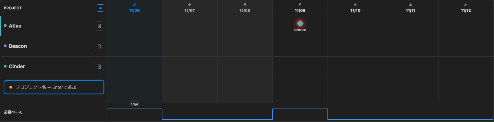

### Event詳細

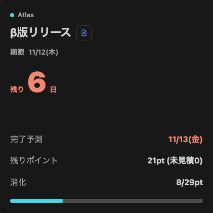

選択したEventの期限、残り日数または超過日数、残りポイント、進捗を確認できる。\
見積もりに必要な情報がそろうと、完了予測も表示される。

### Story一覧

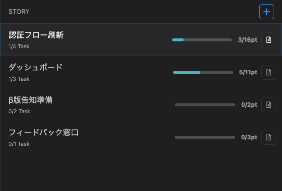

StoryはEvent内の作業をまとめる単位である。\
Storyを選ぶと、右隣にそのStoryのTaskが表示される。\
見出しの **＋** でStoryを追加できる。\
入力後はEnterで保存、Escで取り消す。

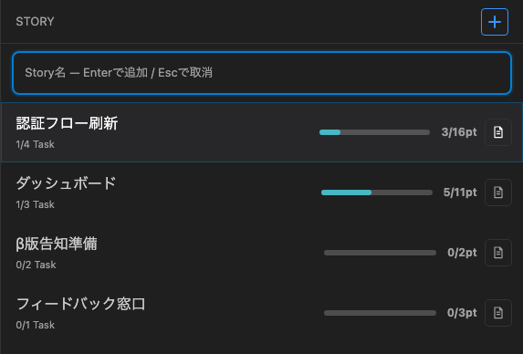

### Task一覧

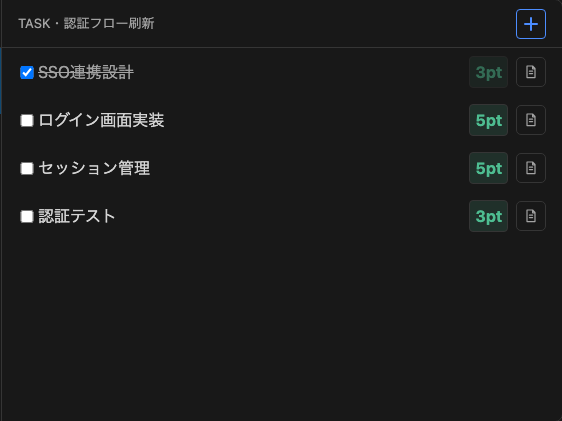

Taskのチェックで完了状態を切り替えられる。\
ポイントを設定すると、残り作業量や期間負荷の計算に反映される。\
見出しの **＋** でTaskを追加できる。\
入力後はEnterで保存、Escで取り消す。

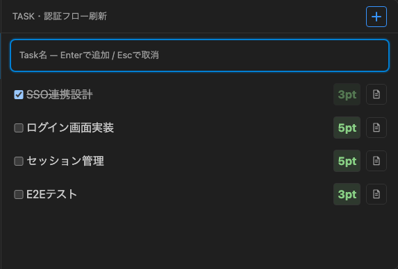

## サイドバーのEVENT一覧

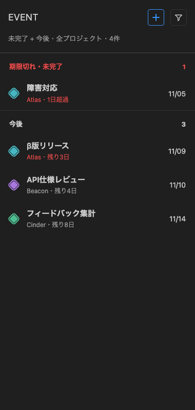

Eventは期限切れ、今週、今後、完了済みなどに分かれて表示される。\
Eventを選ぶとボードが開き、そのEventに移動する。\
上部のフィルターでは、表示対象とProjectを切り替えられる。

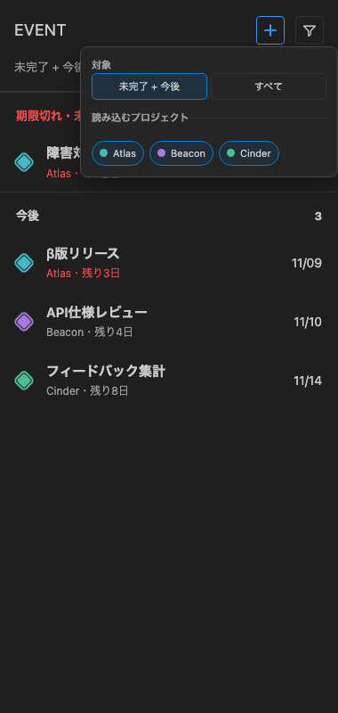

**＋** でEventを追加する。\
Projectを選んで名前を入力し、**「期限を選ぶ」** を押すとカレンダーから日付を選べる。
前月・翌月のボタンで月を移動し、日付を選んでから**追加**またはEnterで確定する。
期限欄には`YYYY-MM-DD`でも直接入力でき、未入力や実在しない日付は保存できない。
カレンダー内の矢印キーで日付を移動し、EnterまたはSpaceで選択する。
Escや枠外クリックはカレンダーだけを閉じ、入力内容を保持する。

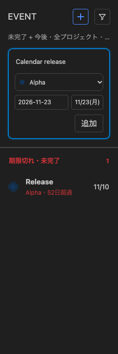

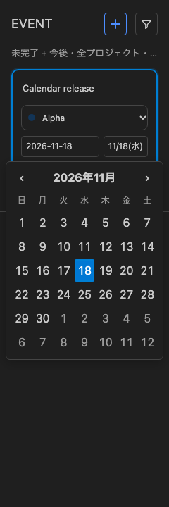

## 項目を編集する

Project、Event、Story、Taskの詳細パネルから、名前、色、期限、補足など、その項目に対応する情報を編集できる。\
Taskではポイントも変更できる。\
削除時は対象に含まれる子項目の件数を確認できる。

Eventの**編集**では期限欄へ直接入力するか、期限ボタンから共通カレンダーを開いて日付を選ぶ。
日付を選んだ後に**保存**で確定する。
カレンダー内のEscはカレンダーだけを閉じ、編集中の名前と期限を保持する。

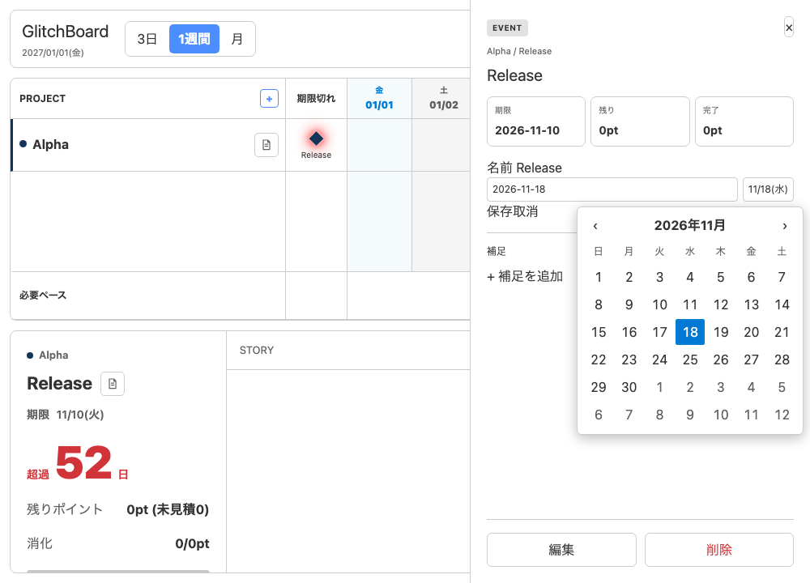

変更は管理ファイルに保存される。\
保存や削除に失敗した場合は画面上部に理由が表示される。\
VS Codeのライトテーマとダークテーマの両方に対応している。

## 学習中の表示

最初にTaskを完了した稼働日を1日目として、10稼働日目になるまで実績ペースは「学習中」と表示される。\
土日や設定した休日は稼働日に数えず、休日に完了したTaskのポイントは次の稼働日に計上する。

学習中は実績ペースを使う完了予測日を表示せず、期間負荷も「—」と表示する。\
10稼働日目から、直近10稼働日の完了ポイント合計を10で割った実績ペースを表示する。\
期限までの日数や期限切れの表示は、学習中も確認できる。

## リポジトリから試す

開発用に動かす場合は、VS Code 1.105以降とNode.js 24を用意し、リポジトリのルートで次を実行する。

```sh
corepack pnpm install --frozen-lockfile
corepack pnpm build
code --new-window --extensionDevelopmentPath="$PWD/packages/extension" .
```

開発用の確認コマンドは次のとおりである。

```sh
corepack pnpm test
corepack pnpm typecheck
corepack pnpm check
corepack pnpm check:fsd
```

製品の目的は[product.md](openspec/product.md)、仕様の読み順は[仕様の案内](openspec/specs/README.md)、要件と実装・テストの対応は[traceability.md](openspec/traceability.md)を参照する。
