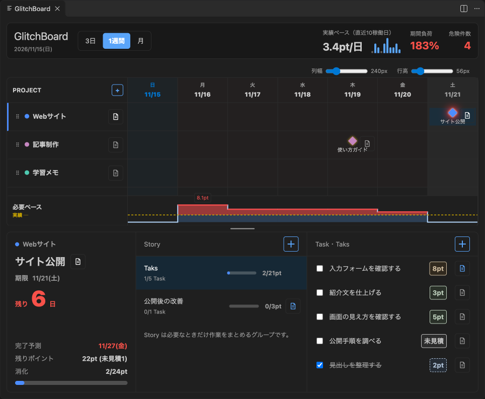
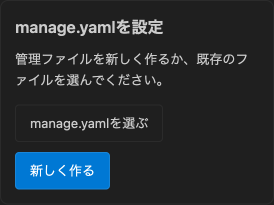
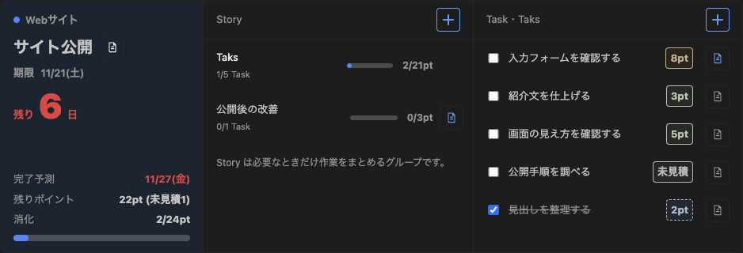
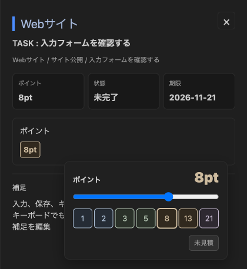
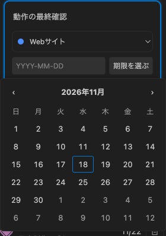

# GlitchBoard

**複数の Project の期限、進捗、作業量を、VS Code の一画面で見渡す。**

個人用のタスク管理拡張である。\
期限をタイムラインで確認し、Event ごとの作業を追加、見積もり、完了できる。\
データはローカルの YAML に保存し、作業フォルダを切り替えても同じボードを使える。

**0.1.x から更新する場合:** 0.2.x は再設計版であり、旧管理ファイルの互換性と移行は提供しない。\
更新前に `manage.yaml` と Project ファイルをバックアップし、新しい空の保存先から始める。\
旧ファイルの自動変換、削除は行わない。\
更新手順と変更点は[変更履歴](CHANGELOG.md)を参照する。

<a href="packages/extension/media/readme/overview.png"></a>

画面例は撮影用の[サンプルデータ](examples/readme-guide/manage.yaml)を使った実画面である。\
すべて同じダークテーマ、表示倍率で撮影している。\
全体画像は左の EVENT 一覧とメインボードを同時に表示し、本文幅に合わせて縮小する。\
画像を開くと元の大きさで文字と操作ボタンを確認できる。

## 導入して使い始める

VS Code 1.105 以降が必要である。\
この README は再設計版 0.2.3 向けである。\
拡張 ID は旧版と同じ `Glitch-Sound.glitchboard` である。

1. [Marketplace の GlitchBoard](https://marketplace.visualstudio.com/items?itemName=Glitch-Sound.glitchboard)をインストール、または0.2.3へ更新する。
2. アクティビティバーの GlitchBoard、またはコマンドパレットの `GlitchBoardを開く` を選ぶ。
3. 初回は左の `新しく作る` で `manage.yaml` の保存先を指定する。\
   既存の本版データがあれば `manage.yamlを選ぶ` を使う。
4. 設定後に開くボードの PROJECT の `+` で Project を作る。
5. 左の EVENT の `+` で名前と期限を登録し、下部の Task の `+` で作業を追加する。

<a href="packages/extension/media/readme/setup.png"></a>

設定済みなら、次回は EVENT 一覧とメインボードが一緒に開く。\
管理ファイルが未設定または見つからない場合は、左だけに設定案内を表示する。

## 作業を追加して進める

基本は **Project > Event > Task** である。\
Event は期限のある目標、Task はそのための作業を表す。\
**Story を先に作る必要はない。**\
Event へ直接追加した Task は、一覧の `Taks` に表示する。\
必要なときだけ Story の `+` でグループを作り、その Story を選んで Task を追加できる。

<a href="packages/extension/media/readme/tasks.png"></a>

| やりたいこと           | 操作                                                                                |
| ---------------------- | ----------------------------------------------------------------------------------- |
| 作業を表示する         | 左の Event またはタイムラインの ◆ を選ぶ。同日の複数 Event は件数から選ぶ           |
| 選択と詳細を使い分ける | 名前や行の余白で選択し、書類アイコンで詳細を開く。詳細表示中は選択先へ追従する      |
| 追加する               | 各見出しの `+` から入力し、Enter で確定、Esc で取り消す                             |
| 表示順を変える         | Project、Story、Task の `⠿` をドラッグして行の前後へ移す。上下キーでも隣へ移せる    |
| 完了と解除             | Task のチェックを切り替える                                                         |
| 見積もる               | ポイントバッジを押し、スライダーか数値を選ぶ。1、2、3、5、8、13、21と未見積を使える |
| 名前、期限を変える     | 詳細の `編集` から変更して保存する                                                  |
| 補足を追加、変更する   | 詳細の `+ 補足を追加` または `補足を編集` から入力して保存する                      |
| Project の色を変える   | Project 詳細のピッカー、または `#RRGGBB` のカラーコードを使う                       |
| Project を片付ける     | Project 詳細の `編集` で `アーカイブ` を選び、保存する                              |
| 削除する               | 詳細の `削除` から、子項目を含む件数を確認して確定する                              |

<a href="packages/extension/media/readme/task-points.png"></a>

Story は同じ Event 内、Task は同じ所属内で並べ替える。\
Taks は先頭固定で、その中の Task は並べ替えできる。\
並べ替えは保存完了後に反映し、保存失敗では元の順序と下書きを保つ。

日付の ◆ と同日 Event 一覧は選択に使い、詳細ボタンは置かない。\
Event の詳細は左の EVENT または下部の要約、Project の詳細は PROJECT 名列の書類アイコンから開く。\
詳細を開いている場合は、選択先へ追従する。

ポイントと完了チェックはその場で保存する。\
完了済み Task のポイントを変える場合は、チェックを外してから操作する。

アーカイブは PROJECT 一覧の行と期限マーカーだけを非表示にする。\
EVENT 一覧、関連データ、集計は残り、再起動後も状態を維持する。\
アーカイブ済み Project を再表示、復元する操作は用意していない。

Event の期限は `YYYY-MM-DD` の入力とカレンダーの両方に対応する。\
日付を選んでから `追加` または `保存` で確定し、カレンダー内の Esc はカレンダーだけを閉じる。

<a href="packages/extension/media/readme/event-add.png"></a>

編集中の移動では保存、破棄、キャンセルを選べる。\
追加先が変わる場合も下書きを確認し、キャンセルでは元の入力と選択を保つ。\
保存失敗では理由を表示して入力を残す。\
保存済みの変更を取り消す履歴機能はないため、必要に応じてデータを Git などで管理する。

## 期限と作業量を見る

| 表示               | 見方                                                                                   |
| ------------------ | -------------------------------------------------------------------------------------- |
| 3日、1週間、月     | 表示期間を切り替える。月は当月全体を表示する                                           |
| タイムラインの ◆   | Event の期限。期限切れの Event は左の一覧で扱う                                        |
| 必要ペース         | 期限に間に合わせるための1稼働日あたりの作業量。青い面で示す                            |
| 実績ペース         | 直近10稼働日の完了ポイントから計算する作業速度。グラフでは黄色の破線で示す             |
| 期間負荷と危険件数 | 期間内の必要作業量と実績ペースを比較する。赤い部分は負荷や期限の確認が必要な目安となる |
| Event の要約       | 残り日数、残りポイント、消化、完了予測を確認する                                       |

未見積の Task は計算上3ptとして扱う。\
実績ペースは最初の完了から10稼働日目になるまでは `学習中` となり、実績を使う負荷と完了予測は表示しない。\
学習中も期限と必要ペースは確認できる。\
休日に完了した Task のポイントは次の稼働日へ計上する。\
期限接近、期限切れ、予測の溢れは赤、期限の4〜7日前は黄色の注意で示す。

左の抽出条件で `未完了 + 今後` と `すべて` を切り替え、読み込む Project を選べる。\
読み込みを外した Project はボード全体の表示と集計から除外する。\
日付見出しはタイムライン上端、必要ペースのグラフは下端に固定され、Project 一覧を縦にスクロールしても確認できる。\
Project 名セルの右端を左右にドラッグすると列幅、下端を上下にドラッグすると全 Project の行高を変更できる。\
見出し右端では左右キー、最初の Project の下端では上下キーも使える。\
Home またはダブルクリックで既定値へ戻り、調整中の Esc で取り消す。\
寸法は同じ VS Code プロファイルでのタブの開き直しや再起動でも維持する。\
上下の表示領域は境界のドラッグか上下キーで調整できる。\
境界の Home またはダブルクリックで上下の初期比率へ戻す。\
固定部分と行の操作が重ならない高さを確保し、極端に小さい画面ではボード全体も縦スクロールできる。\
Project の並び順は左端のハンドルのドラッグか上下キーで変えられる。

## 保存先と設定

管理ファイルの場所はユーザー設定 `glitchboard.manageFile` に絶対パスで保存する。\
現在のワークスペースとは別のフォルダにも置ける。\
Project を追加すると `projects/0001_名前.yaml` のようなファイルを作り、相対パスを管理ファイルへ登録する。

```yaml
settings:
  workdays_off: [sat, sun]
  public_holidays: true
projects: []
```

休日は `workdays_off`、日本の祝日を休みにするかは `public_holidays` で指定する。\
管理ファイルと Project ファイルの `.yaml` と `.yml` の外部変更も反映する。\
この拡張はデータの外部送信や自動同期を行わない。\
Git による保存と共有は利用者が行い、同時編集の競合解決や旧版からの移行は提供しない。

## 開発

VSIX の作成、ソースからの起動、検査と開発資料は [開発手順](DEVELOPMENT.md)を参照する。
