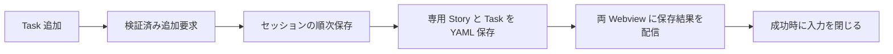

# リプレース報告

## 実装の基準と調査

`glitchboard-ex` の main、コミット `7daf07c3128eb847d14d9cc374dc72d593329915` を取得して調査した。\
指定先は空であり、元実装の packages、テスト、サンプル、文書を基礎として取り込んだ。\
`openspec-template` はコミット `3224955f87122339c8961563c6d964d90a7c8521`、テンプレート版は `.openspec-template` に記録した。

調査対象は README、全体の仕様と差分仕様、共有スキーマ、計算、YAML 永続化、セッション、VS Code の両 Webview 入口、タイムライン、追加と編集部品、既存テストと検証スクリプトである。\
元版の画面資料も確認した。\
着手時の基準検証は83ファイル、152テスト、型検査、Biome、FSD 検査、ビルドのすべてが成功した。\
Mac の過去メモリには依存せず、現物を基準にした。

元版は TypeScript、React、Zustand、Zod、YAML、Vite と VS Code Webview を使う3パッケージ構成である。\
サイドバーの Event 一覧とエディタのボードが同一セッションを共有し、YAML の保存後にスナップショットを配信する。\
負荷、休日、未見積、完了予測、学習中の計算は共有パッケージにまとまっている。\
これらの機能を維持するため、技術スタックと保存境界を継続した。

確認した問題は次のとおりである。

- 空の Event は Story がないと Task 追加ボタンを出せない。
- Event オブジェクトの更新だけで Story 選択と追加入力を初期化する。
- 詳細の名前と補足は保存結果を待たずに編集欄を閉じる。
- 編集を取消して再開しても、破棄した値がローカル状態に残る。
- ボードだけで Event を作れず、サイドバーへ移る必要がある。
- 並行した保存要求は同じ YAML の read-modify-write を競合させる可能性がある。
- 元 change の検証に、分割領域を端へ調整してから画面縮小すると最小高さを下回る警告が残っている。

## 設計と変更

| 判断 | 採用した方法と理由 | 代替案の影響 |
| --- | --- | --- |
| Story を任意にする | 最初の直接 Task 保存時に `isDefault: true` の Story を作る | Event に tasks 配列を足すと旧版の集計と操作が読めなくなる |
| 旧データを守る | 名前で特別扱いせず、既存の ID と通常 Story を維持する | 「デフォルト」等の名前一致による転用では既存 Story と衝突する |
| 空データを増やさない | 専用グループは未保存でも表示し、最初の Task と一緒に保存する | Event 作成時に空 Story を必ず保存すると不要な構造が増える |
| 選択と下書きを保つ | 同一 Event の更新と、選択先消失や Event 切替を区別する | オブジェクト参照だけでリセットすると通常の完了変更でも入力を失う |
| 保存を安定させる | セッションで要求を順次処理し、UI は保存結果と操作世代を確認する | 同時保存では取りこぼし、遅い応答では新しい下書きを消す恐れがある |
| 詳細への導線 | Project、Event、Task 名を button にし、既存の詳細ボタンも残す | 全行クリックではチェック、ポイント、移動ハンドルと競合する |
| 作成後の操作 | ボードにも共通 Event フォームを置き、新 Event を選択する | サイドバー移動と追加後の検索が必要になる |

空の Event への最初の Task は、Story 追加と確定を省き、Task ＋ と確定だけで登録できる。\
従来の詳細アイコンも1操作で開けるため、名前クリックによる改善はクリック数の削減ではなく、広い対象と自然な入口の追加である。

UI はテーマ変数、共通の操作サイズと角丸、フォーカス、編集フォームをそろえた。\
作業グループの説明、空状態の案内、名前からの直接詳細表示、カレンダーと編集の段階的な Esc、詳細終了後のフォーカス復帰を追加した。\
既存のタイムライン、負荷計算、ポイント、完了、補足、Project 順序、フィルター、削除と初期設定は維持した。

## OpenSpec の置換

共通 AGENTS.md、ears-bdd、共通トレーススクリプト、manual-checks を指定テンプレートから導入し、既存フック向けの手順に従って Lefthook に全体検証を設定した。\
OpenSpec は1.16.0に固定し、Codex 用の7スキルを生成した。\
生成時の設定は一時 XDG_CONFIG_HOME に分離した。

元の実装済み差分2件は正式仕様へ取り込み、元成果物を imported を含む名前で履歴へ保存した。\
そこに記載された過去の検証結果は今回の検証として流用していない。\
旧 schema は歴史的成果物の説明用に残し、現行の開発は ears-bdd で行う。\
既存要件の長すぎる本文は意味とシナリオを変えずに短縮して、厳格検査へ適合させた。

`npm run check` を全体検証へ変更し、従来の Biome 単独実行は `npm run lint` へ分離した。\
`check:product` は lint、型検査、FSD、全テスト、ビルドを含む。\
標準の `npm run` で動くよう、pnpm のグローバル実行ファイルには依存しない。\
開発用 VS Code 設定から、元リポジトリにあった個別の管理データパスを除いた。

## テストと検証

追加テストは未実装で失敗することを確認してから実装した。\
画面状態の5テストは元 EventDetails へ一時的に戻すと全件失敗することも確認した。\
既存の初期選択など、もともと実装されている部分は元テストを維持し、シナリオ ID の不足だけを補った。

意図した振る舞い変更に対応し、空 Event の案内を Story 必須から直接 Task 追加へ変更した。\
また、既存の日付テストの最後の Esc 確認を、編集取消後に詳細を閉じる2段階へ変更した。\
カレンダーだけを閉じて入力を保つ既存の確認はそのまま残した。

実ブラウザー検証は Chromium の実ビルドに本物の BoardSession と一時 YAML ファイルを接続する。\
置き換えるのは VS Code API の transport だけであり、画面内で成功を捏造する保存モックは使わない。\
両テーマで3回の追加と毎回の取消、実 EACCES、再送、名前編集、補足、削除確認の取消、ポイント、完了と解除、通常 Story の追加、更新中の下書き、画面縮小、再読込とボードからの Event 作成を操作した。\
旧 Story、Task の属性と YAML コメントも照合した。

最終の検査結果は下記の証跡と、この節の末尾に記録する。

- [ブラウザー結果](../artifacts/replacement/browser-results.json)
- [ライトテーマ](../artifacts/replacement/board-light.png)、[ダークテーマ](../artifacts/replacement/board-dark.png)
- [詳細のライトテーマ](../artifacts/replacement/detail-light.png)、[詳細のダークテーマ](../artifacts/replacement/detail-dark.png)

README には画面キャプチャを追加していない。\
ビルドには元版から続く Zod 依存の PURE 注釈警告が出るが、ビルドは成功する。

## 残課題と最終確認

最終の VS Code 実操作は利用者が行う。\
この作業では実 Webview transport と VS Code 本体の GUI の最終試用を代行していない。\
隔離した起動方法と9項目の確認手順を [manual-checks.md](../openspec/manual-checks.md) に残した。

- Task の Story 間移動 UI は追加していない。
- 保存用の専用グループも4階層の Story として保持するため、削除確認の Story 件数に含まれる。
- 旧版で専用 Story の名前や属性を手で変える場合は、新版の専用グループ判定に注意する。
- 公開と運用開始の承認はしていない。
  Marketplace 公開、GitHub push とリモート設定は行わない。

## 最終結果

2026-11-14 に全88ファイル、172テストが成功した。\
Biome、型検査、FSD、ビルド、7 capability の厳格仕様検査、トレース検査、差分の空白検査が成功した。\
変更単位の厳格仕様検査と厳格トレース検査も成功した。\
追加5要件、変更2要件の24シナリオと4設計判断を検証し、既知の未解決指摘はない。\
カレンダー12組合せ、初期設定8組合せ、両テーマの layout と今回の実保存フローはすべて成功した。

[最終検査ログ](../artifacts/replacement/check.log)、[検査結果 JSON](../artifacts/replacement/check-results.json)、[アーカイブした検証記録](../openspec/changes/archive/2026-11-14-simplify-event-workflow/verification.md) を参照する。\
正式仕様への同期とアーカイブを終え、未完了の change はない。\
9件の最終実機確認は利用者向けに残している。
