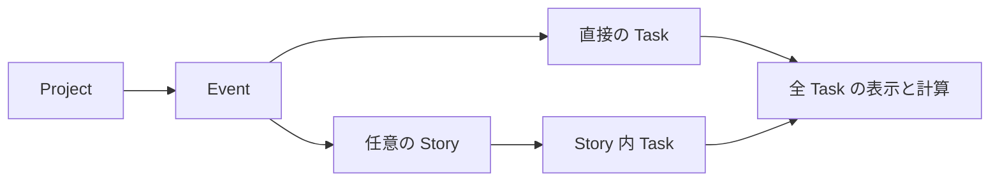

# リプレース報告

## 方針と調査

最終方針は、旧管理ファイルの移行と互換性を対象外とし、今回採用する要件と指定の OpenSpec テンプレートを正とする。\
当初は互換性のために自動 Story を実装したが、利用者の追加指示に従って撤回し、Event に Task を直接保存するモデルへ変更した。\
現在の成果物に旧版の OpenSpec アーカイブ、旧 schema、過去の画面証跡は含めない。

参考にしたのは `glitchboard-ex` のコミット `7daf07c3128eb847d14d9cc374dc72d593329915` である。\
README、仕様、共有モデルと計算、YAML、セッション、VS Code 入口、両画面、追加と編集、テストを調査した。\
着手時の参考実装は83ファイル、152テストと静的検査、ビルドが成功した。\
この結果は現行成果物の合格証跡とは区別する。

TypeScript、React、Zod、YAML、Vite と shared、extension、webview の責務分離は、今回の用途に適するため再利用した。\
全面的な書き直しや旧挙動の継承を目的にはせず、採用した機能を新モデルで検証した。\
Mac の過去メモリには依存していない。

## 採用した要件と設計

| 採用する機能 | 判断 |
| --- | --- |
| Project と期限付き Event | 複数の仕事と期限を見渡す基本単位とする |
| Event 直下の Task | 事前の Story 作成を不要とし、Event.tasks に直接保存する |
| 任意の Story | 作業をまとめたい場合だけ利用者が作る |
| タイムラインと Event 一覧 | 期限から作業へ到達する入口として採用する |
| 進捗、負荷、実績ペース、完了予測 | 直接と Story 内の Task を等しく集計する |
| YAML 保存 | 個人利用、外部通信不要、Git での管理に適する |
| 名前から詳細、共通追加と編集 | 対象を探す操作と画面間の移動を減らす |

「EventのTask」は直接 Task の表示名であり、保存用の Story ではない。\
tasks と stories の省略は空として扱う。\
Task の走査と保存先の解決を共有し、表示だけ対応して計算や削除で漏れることを防ぐ。\
読込時に旧属性を除去する移行処理を外し、利用者の保存操作まで YAML を変更しない。

空の Event への最初の Task では、Story ＋ と確定を省ける。\
ボードから Event を追加するとその Event が選択され、そのまま Task を追加できる。\
Project、Event、Task の名前と詳細アイコンは1操作で詳細へ進み、Story 名は Task 一覧の選択を行う。\
直接 Task が未完了なら、Event 選択時に直接 Task を初期表示する。

同一 Event の更新では選択と追加の下書きを維持し、保存は成功した後だけ編集を閉じる。\
取消後の遅い応答が新しい入力を消さないよう、操作の世代を照合する。\
セッション内の保存要求は順次処理する。\
Esc はカレンダー、削除確認、編集、詳細の順で現在の操作だけを閉じる。\
テーマ変数、操作の枠とサイズ、フォーム、フォーカスをそろえ、空状態に次の操作を示した。

## OpenSpec

テンプレートは `3224955f87122339c8961563c6d964d90a7c8521` を参照し、共通 AGENTS.md、ears-bdd、共通トレース検査、manual-checks を導入した。\
OpenSpec 1.16.0 を固定し、Codex 用の7スキルを生成した。\
生成時の設定は一時 XDG_CONFIG_HOME に分離した。\
既存フック向けの手順に従い、Lefthook の pre-commit から `npm run check` を実行する。

現行の仕様は `openspec/specs/` の7 capability に整理した。\
旧仕様を互換性契約として扱わず、採用した機能の要件として確認した。\
今回の方針変更は `native-event-tasks` の提案、差分仕様、設計、タスク、検証に記録する。\
`check` はプロダクトの lint、型検査、FSD、全テスト、ビルドの後に、厳格仕様とトレースの検査、台帳生成を行う。\
Biome 単独の実行は `npm run lint` へ分離した。

## 検証方法と根拠

新モデルの保存、Story 非作成、重複 ID、読込非変更、直接 Task の表示と計算について、先にテストを変更または追加して失敗を確認した。\
方針として除いた旧属性移行のテストは削除し、読込のバイト列が変わらない検査へ置き換えた。\
不要になった過去の検証資料を除き、現在の実装で検査を実行した。

| 確認 | 結果の具体例 |
| --- | --- |
| 保存と再読込 | Event.tasks に追加し、Story は自動生成しない |
| 進捗と残作業 | 直接 Task と Story 内 Task の合計23pt、完了10pt、残り13pt |
| 実績ペース | 直近10稼働日の完了8ptから0.8pt/日を計算する |
| 完了と解除 | 8ptを完了すると残り5pt、実績1.6pt/日へ変わり、解除で元へ戻る |
| 負荷と予測 | 残り13ptから5ptへの変化が期間負荷と完了予測へ反映される |
| 子件数と削除 | 直接 Task 2件と Story 内1件は Story 1件、Task 3件と表示する |
| 個別削除と全体削除 | 直接 Task の個別削除と、Event 配下を含む削除を実 YAML で確認する |
| 取消と保存失敗 | 入力を残して実 EACCES から復帰し、削除取消では要求を送らない |
| 読込の非変更 | 注釈と未使用属性のある YAML を繰り返し読み、全バイト列を照合する |

ブラウザー検証は実ビルドと本物の BoardSession、一時 YAML を接続する。\
VS Code API の transport だけを置き換え、保存は本物の処理を使う。\
両テーマで連続追加と毎回の取消、実保存失敗と再送、名前と補足、完了と解除、ポイント、グループ、再読込、子件数と削除を確認する。\
カレンダーは2時間帯、2テーマ、3表示面の12組合せ、初期設定は8組合せ、layout は両テーマで検査する。

現在の証跡は [検査ログ](../artifacts/replacement/check.log)、[結果 JSON](../artifacts/replacement/check-results.json)、[実保存 UI](../artifacts/replacement/browser-results.json) に置く。\
画面証跡は artifacts/replacement/ に保存し、README への画面キャプチャ追加は行わない。

## 残課題と最終確認

最終の VS Code 実機操作は依頼どおり利用者が行う。\
[manual-checks.md](../openspec/manual-checks.md) に隔離起動と9項目の手順を残した。\
新しい管理ファイルを作成して試す。\
旧データの移行と互換性、Task の Story 間移動 UI は提供範囲に含めない。

実 Webview transport と VS Code 本体の最終 GUI 試用は、この作業では代行していない。\
ビルドには依存する Zod の PURE 注釈警告が出るが、出力の生成は成功する。\
GitHub push、リモート設定、Marketplace 公開は行わない。

## 最終結果

2026-11-14 に最終状態の全89ファイル、175テストが成功した。\
lint、型検査、FSD、ビルド、全7 capability の厳格仕様、トレースと差分空白の検査が成功した。\
今回の変更は8タスク、6要件、16シナリオを照合し、既知の未解決指摘はない。\
両テーマの実保存、個別と Event 全体の削除、カレンダー12組合せ、初期設定8組合せ、layout の確認も成功した。

[設計](../openspec/changes/archive/2026-11-14-native-event-tasks/design.md) と [検証記録](../openspec/changes/archive/2026-11-14-native-event-tasks/verification.md) を参照する。\
正式仕様への同期とアーカイブを終え、未完了の change はない。\
ユーザーの最終実機確認9件は手順書に残している。
