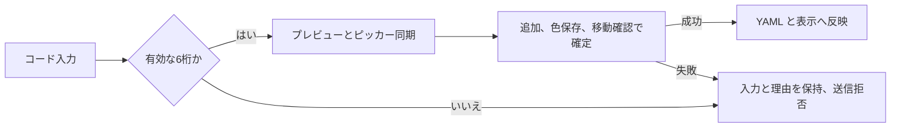

# 設計

## 背景と制約

- 提案: [proposal.md](proposal.md)
- 前提: openspec/tech.md の データ保存、レコード操作、テスト方針
- 保存スキーマは既に # と16進数6桁であり、詳細のネイティブピッカーは即時保存である。

## 設計判断

### D-01 - 既存形式を共通入力へ使う

- 選択: shared の色スキーマと正規化関数、Webview の shared/ui/color-input を共用する。
- 理由: Timeline、InlineAdd と詳細で、有効値とピッカーの表示がずれない。
- 代替案: CSS の色名、短縮形と透過色は YAML の形式を広げるため使わない。
- 昇格: openspec/tech.md の 色の入力

### D-02 - コードを下書きとして扱う

- 選択: 詳細の直接入力には保存と取消を置き、Escape はコードだけを戻す。移動確認では名前、補足と色を同じパッチへまとめる。
- 理由: 一文字ごとの保存や、名前の編集中に色の保存で入力を失うことを防ぐ。
- 代替案: blur での自動保存は明示的な取消をしにくいため使わない。
- 昇格: openspec/tech.md の 色の入力

## 検証計画

| シナリオID | 設計判断 | 検証方法 |
| --- | --- | --- |
| REQ-042-S01 | D-01 | 自動テスト |
| REQ-042-S02 | D-01、D-02 | 自動テスト |
| REQ-042-S03 | D-01、D-02 | 自動テスト |
| REQ-042-S04 | D-02 | 自動テスト |
| REQ-042-S05 | D-02 | 自動テスト |
| REQ-042-S06 | D-01、D-02 | 自動テスト |

形式の境界は共通部品、入口の配線と移動は画面、実保存と両テーマの表示は実ビルドのブラウザーで確認する。\
旧版の移行と新しい非機能指標は対象外であり、非該当である。

## リスクと移行

Project 列の最小幅でも追加欄を操作できるよう、名前、色、確定操作を縦へ配置する。\
無効なコードはプレビューへ渡さず、最後の有効な色を示す。\
保存失敗ではコードを保持し、未保存確認のキャンセルでも色以外の下書きを消さない。\
共有メッセージの既存の色検証、YAML のコメントと UUID は維持し、移行は不要である。
