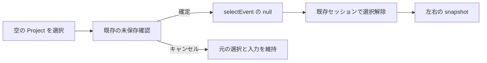

# 設計

## 背景と制約

- 提案: [proposal.md](proposal.md)
- 前提: openspec/tech.md の レコード操作、レコードの選択表現

## 設計判断

### D-01 - 既存の選択解除を配信する

- 選択: selectEvent.eventId に null を許可し、BoardApp は Event がない場合も確定処理で送る。BoardSession は既存の null 分岐で選択 Event と Project 参照を解除し、左右へ snapshot を配信する。確定した scoped Event 選択を BoardApp の比較用参照にも記録し、同じ選択の応答や再表示で空 Project の選択をリセットしない。
- 理由: ローカルだけの解除を残さず、既存の確認経路と接続の検証を維持する。
- 代替案: 左へ独自の局所状態を追加する方法は再表示とキャンセルで状態がずれるため使わない。
- 昇格: openspec/tech.md の レコードの選択表現

## 検証計画

| シナリオID | 設計判断 | 検証方法 |
| --- | --- | --- |
| REQ-035-S01 | D-01 | 自動テスト |
| REQ-035-S02 | D-01 | 自動テスト |
| REQ-035-S03 | D-01 | 自動テスト |
| REQ-035-S04 | D-01 | 自動テスト |
| REQ-035-S05 | D-01 | 自動テスト |

null の形式と無効値は共有境界で、解除の配信と保存しないことは実 BoardSession で確認する。\
実ブラウザーでは空 Project への入力保護と確定後の左右の表示を確認する。

## リスクと移行

既存の UUID 指定の選択は維持し、null は解除だけに使う。\
左からの通常の移動は従来どおり UUID と Project 参照で行い、null を移動要求へ変換しない。\
YAML、UUID とコメントを変更せず、移行は不要である。
