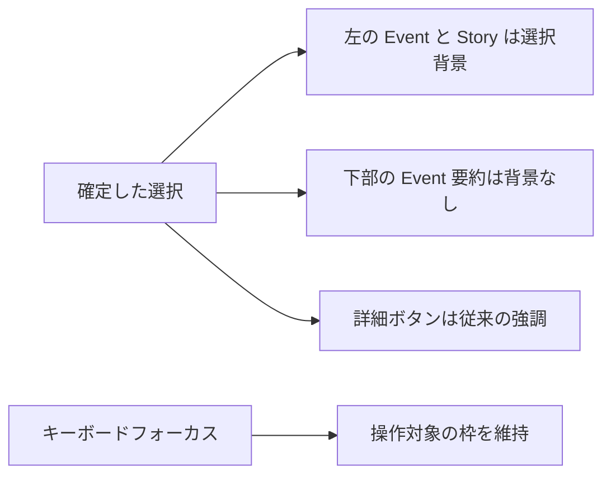

# 設計

## 背景と制約

- 提案: [proposal.md](proposal.md)
- 前提: openspec/product.md の 画面と操作、openspec/tech.md の レコードの選択表現。
- 前回からの変更は Event 要約と Story の背景だけであり、選択枠は引き続き付けない。
- 共有スキーマ、通信境界、YAML コメントと ID、保存と取消の動作を変更しない。

## 設計判断

### D-01 - 背景の役割を場所で分ける

- 選択: Event の選択背景の共通指定から event-summary を外し、story-choice.selected に同じ選択背景を適用する。
- 理由: 左の Event を保ち、下部の要約だけを背景なしにできる。Story の背景は既存の選択行と同じ役割になり、詳細強調とフォーカスを変えずに済む。
- 代替案: Event 全体の選択背景をなくすと左の一覧も変わる。Story の選択枠を戻すと最新指定に反するため採用しない。
- 昇格: openspec/tech.md の レコードの選択表現。

背景の調整値は既存の選択背景35%を維持し、style.css の共通指定1か所を正とする。\
新しい色と寸法は追加しない。

### D-02 - 現状維持と変更箇所を別に検査する

- 選択: Project、左の Event、Task、マーカーと同日一覧を変更前の計算済みスタイルと完全一致で比較し、Story と要約は新しい期待値を検査する。
- 理由: 背景を共通化した変更が維持対象へ波及した場合に検出できる。
- 代替案: 色があるかだけを見ると、左の Event や Task の色や枠の変更を見逃す。
- 昇格: なし。

### D-03 - 実画面と同梱を更新する

- 選択: 同じ隔離プロファイルの撮影手順で README の画像を再取得し、13px、倍率0、Default Dark Modern と85%表示を維持する。実 VS Code のライトも確認する。
- 理由: 影響する全体像と下部の作業一覧を新 UI へ揃え、説明用の画面を加工しない。
- 代替案: 古い背景だけを画像編集して差し替える方法は採用しない。
- 昇格: なし。

## 検証計画

| シナリオID | 設計判断 | 検証方法 |
| --- | --- | --- |
| REQ-030-S01 | なし | 自動テスト |
| REQ-030-S02 | D-01、D-02、D-03 | 自動テスト |
| REQ-035-S01 | D-02 | 自動テスト |
| REQ-035-S02 | D-02 | 自動テスト |
| REQ-035-S03 | D-01、D-02、D-03 | 自動テスト |
| REQ-035-S04 | D-02 | 自動テスト |
| REQ-035-S05 | D-02 | 自動テスト |

背景と状態は実ビルドの Chromium で、名前、余白、ホバー、選択、フォーカスを両テーマで確認する。\
既存の予測と進捗は部品テスト、選択と編集保護は既存の処理の流れの検査を維持し、同じ判断を別の層で繰り返さない。\
保存と入力の有効範囲を変更しないため、新しいデータ境界と異常入力は追加しない。\
実機台帳は最終確認用に未確認のまま更新し、利用者の最終操作確認を代行した扱いにしない。

## リスクと移行

共通スタイルの対象の漏れは、変更前との比較と実画面で確認する。\
データ移行はない。
