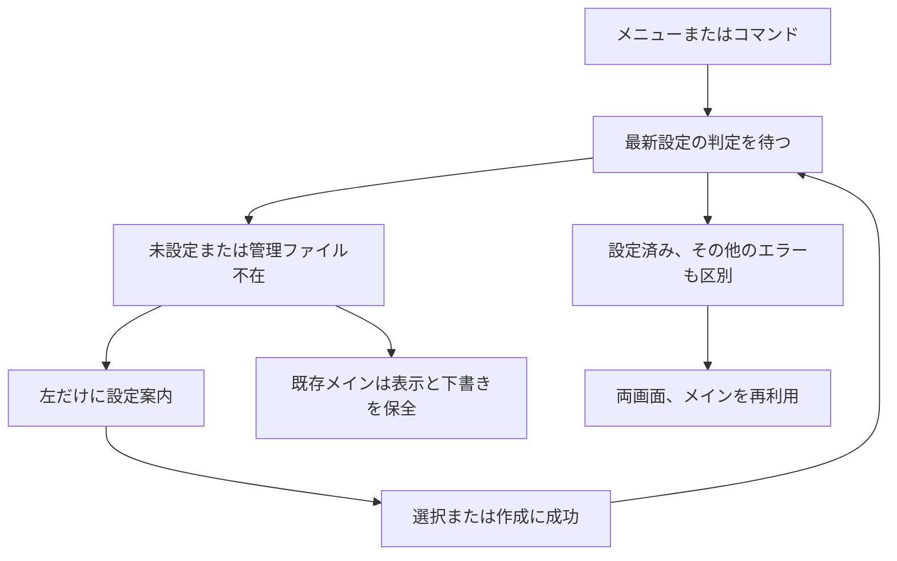

# 設計

## 背景と制約

提案は proposal.md、前提は openspec/tech.md の 参照と接続とレコード操作である。\
現在の BoardSession は管理ファイルの ENOENT だけを missing とし、構文、権限、Project の問題は ready とエラーで返す。

## 設計判断

### D-01 - 判定後にメインを開く

- 選択: 最新の設定読込が完了するまで待ち、起動直前にも再読込して監視通知前の削除と復元を判定し、未設定と missing は左の一覧だけ、その他の設定済み状態は両画面とする。コマンドも同じ入口に通す。既存メインの再利用とナビゲーションの ready 待ちを維持する。
- 理由: 設定文字列だけで開くと、欠落ファイルの初回判定前にメインと案内が出る。
- 代替案: すべての読込エラーを未設定にする案は、Project の欠落や構文不正を設定の問題へ誤分類する。
- 昇格: openspec/tech.md の 起動と設定案内

### D-02 - 案内と既存表示を分ける

- 選択: 選択と作成のボタンは EVENT 一覧だけに置く。既存メインは閉じず、不在と設定解除で表示と下書きを保ち、接続状態とエラーだけを表示する。新しい接続の初期スナップショットと不在状態で直前の有効表示を消さない。欠落中の操作は既存の Extension 側の検証で拒否する。
- 理由: 強制終了や空の初期状態で未保存入力を失わず、同じ設定案内を重複させない。
- 代替案: 不在時にメインを自動で閉じると編集内容が失われる。
- 昇格: openspec/tech.md の 起動と設定案内

## 検証計画

| シナリオID | 設計判断 | 検証方法 |
| --- | --- | --- |
| REQ-012-S01 | D-01、D-02 | 自動テスト |
| REQ-012-S02 | D-01、D-02 | 自動テスト |
| REQ-012-S03 | D-01、D-02 | 自動テスト |
| REQ-012-S04 | D-01、D-02 | 自動テスト |
| REQ-029-S01 | D-01、D-02 | 自動テスト |
| REQ-029-S02 | D-01、D-02 | 自動テスト |
| REQ-029-S03 | D-01、D-02 | 自動テスト |
| REQ-029-S04 | D-01、D-02 | 自動テスト |
| REQ-029-S05 | D-01、D-02 | 自動テスト |
| REQ-029-S06 | D-01、D-02 | 自動テスト |
| REQ-029-S07 | D-01、D-02 | 自動テスト |
| REQ-029-S08 | D-01、D-02 | 自動テスト |
| REQ-029-S09 | D-01、D-02 | 自動テスト |
| REQ-029-S10 | D-01、D-02 | 自動テスト |
| REQ-029-S11 | D-01、D-02 | 自動テスト |
| REQ-029-S12 | D-01、D-02 | 自動テスト |

判定と繰り返し起動、設定後の再起動は Extension の実ハンドラで確認する。\
案内数と下書きの保持は両アプリを同時に描画し、設定操作そのものの境界は既存テストを維持する。\
実ビルドは両テーマで設定案内の配置と既存メインを確認する。\
通信形式と YAML を変えないため、移行はない。

## リスクと移行

既存メインは強制終了せず、接続可能な場合だけ再表示する。\
外部の復元は既存表示へ反映し、閉じたメインはメニューまたは Event 選択で開く。\
構文不正と権限エラーでは設定案内を出さず、エラーの修正を待つ。
