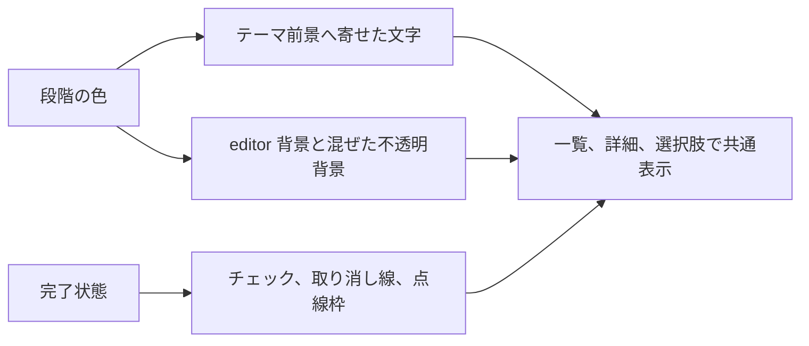

# 設計

## 背景と制約

- 提案: [proposal.md](proposal.md)
- 前提: openspec/tech.md の UI実装、レコード操作、状態の表示
- 既存のオレンジ色と15%の半透明背景、完了行の0.5と disabled の透過が文字を弱めていた。

## 設計判断

### D-01 - 色の役割を分ける

- 選択: ポイントの段階色を --point-accent に置き、文字は段階色25%とテーマ前景75%、背景は段階色10%と editor 背景90%の不透明色へ分ける。係数は app/style.css の共通規則に1か所で定義する。
- 理由: 段階色を残し、背景色や selected 行、Project の設定色へ依存せずに数値を読める。
- 代替案: オレンジの既定値だけ明るくする方法は、完了の透過とカスタム配色に対応しない。
- 昇格: openspec/tech.md の ポイント表示

### D-02 - 完了の表示から透過を外す

- 選択: ポイントは完了と操作不可でも透過せず、点線の枠を使い、一覧の既存のチェックと名前の取り消し線を維持する。
- 理由: 操作できない状態と、文字を読めない状態を結び付けない。
- 代替案: バッジ全体を薄くする方法は数値の可読性を下げるため使わない。
- 昇格: openspec/tech.md の ポイント表示

## 検証計画

| シナリオID | 設計判断 | 検証方法 |
| --- | --- | --- |
| NREQ-003-S01 | D-01 | 自動テスト |
| NREQ-003-S02 | D-01 | 自動テスト |
| NREQ-003-S03 | D-01、D-02 | 自動テスト |
| NREQ-003-S04 | D-01、D-02 | 自動テスト |

色と透過は実 Chromium の算出色を canvas で読み、祖先の背景と opacity を合成して判定する。\
一覧と詳細の配線、完了解除とポイント選択は実アプリで確認する。\
標準配色と任意色は独立して検証し、同じ判断になる全組合せは増やさない。\
通常文字の判定方法は W3C の Contrast (Minimum) を参照し、今回は操作不可のポイントにも同じ4.5:1の基準を採用する。\
[W3C の通常文字のコントラスト基準](https://www.w3.org/WAI/WCAG22/Understanding/contrast-minimum.html)を参照する。

## リスクと移行

文字の色は前景へ寄るが、枠と背景にも段階色を残して色分けを維持する。\
Project 色とチャートの色の変更が文字を埋もれさせないことを確認する。\
YAML、コメント、UUID と通信を変更せず、移行は不要である。
