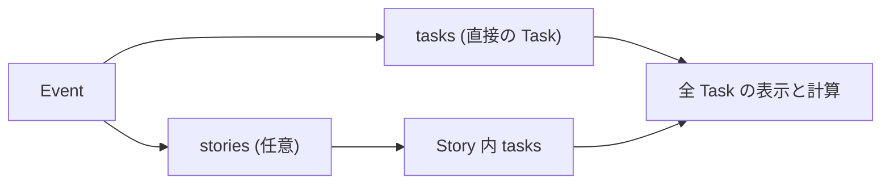

# 設計

## 背景と制約

- 提案: [proposal.md](proposal.md)
- 前提: openspec/product.md の 管理モデル。
- 利用者は旧版のコード、アーカイブ、移行と互換性の継承を不要とした。

## 設計判断

### D-01 - Event へ Task を直接保存する

- 選択: Event.tasks を直接 Task の保存先とし、Event.stories は任意グループとする。
  「EventのTask」は画面上の選択名であり、保存用 Story ではない。
  未完了の直接 Task がある Event は直接 Task を初期選択する。
- 理由: 互換性制約を外した現在の要件を、そのままデータへ表せる。
- 代替案: isDefault Story は不要なデータと削除件数を増やすため廃止する。
- 昇格: openspec/tech.md の 保存モデル

### D-02 - 全 Task の走査を共有する

- 選択: Event 内の直接 Task と Story 内 Task を集める共有関数を、集計、残作業、ペース、完了判定に使う。
  保存処理はどちらも同じ Task 検証と操作型を使う。
- 理由: 表示だけ更新して計算や削除で漏れる問題を防ぐ。
- 代替案: 各画面に別の集計式を持つ方式は採用しない。
- 昇格: openspec/tech.md の 保存モデル

### D-03 - 読込から移行を除く

- 選択: 旧リンク属性の除去を廃止し、読込はファイルを書き換えない。
- 理由: 旧版移行は対象外であり、読込と保存の責務を分ける。
- 代替案: 旧データの自動修復は採用しない。
- 昇格: openspec/tech.md の 保存モデル

### D-04 - 採用する機能だけを現行の仕様とする

- 選択: 旧版由来の archive、schema、画面記録を成果物から除く。
  タイムライン、YAML、負荷、追加と編集は現行の要件として採用し、適合する部品とテストは再利用する。
- 理由: 過去の契約を移行要件として扱わず、実装の根拠を今回の目的へ置く。
- 代替案: 全コードの書き直しは、適合が確認できた部品を失うだけなので行わない。
- 昇格: openspec/structure.md の 開発成果物

## 検証計画

| シナリオID | 設計判断 | 検証方法 |
| --- | --- | --- |
| REQ-028-S03 | D-01、D-02 | 自動テスト |
| REQ-001-S01 | D-01、D-02 | 自動テスト |
| REQ-001-S02 | D-01、D-02 | 自動テスト |
| REQ-038-S01 | D-03 | 自動テスト |
| REQ-033-S01 | D-01、D-02 | 自動テスト |
| REQ-033-S02 | D-01、D-02 | 自動テスト |
| REQ-033-S03 | D-01、D-02 | 自動テスト |
| REQ-033-S04 | D-01、D-02 | 自動テスト |

| REQ-018-S01 | D-01、D-02 | 自動テスト |
| REQ-018-S02 | D-01、D-02 | 自動テスト |
| REQ-018-S03 | D-01、D-02 | 自動テスト |
| REQ-018-S04 | D-01、D-02 | 自動テスト |

| REQ-004-S01 | D-01、D-02 | 自動テスト |
| REQ-004-S02 | D-01、D-02 | 自動テスト |
| REQ-004-S03 | D-01、D-02 | 自動テスト |

| REQ-028-S05 | D-01、D-02 | 自動テスト |

永続化はセッションと一時 YAML、表示と削除確認は UI、計算は共有関数で確認する。\
既存の正常系が最初から成功する場合は、その部品を再利用できる根拠として報告する。\
実ビルドでの反復操作は接続の確認とし、最終 VS Code 実機確認は依頼どおり利用者が行う。

## リスクと移行

旧管理ファイルの移行と互換性は提供しない。\
試用は新規の管理ファイルで始める。\
新しい直接 Task では、保存、詳細解決、削除、完了判定とすべての計算で漏れないことを検証する。
