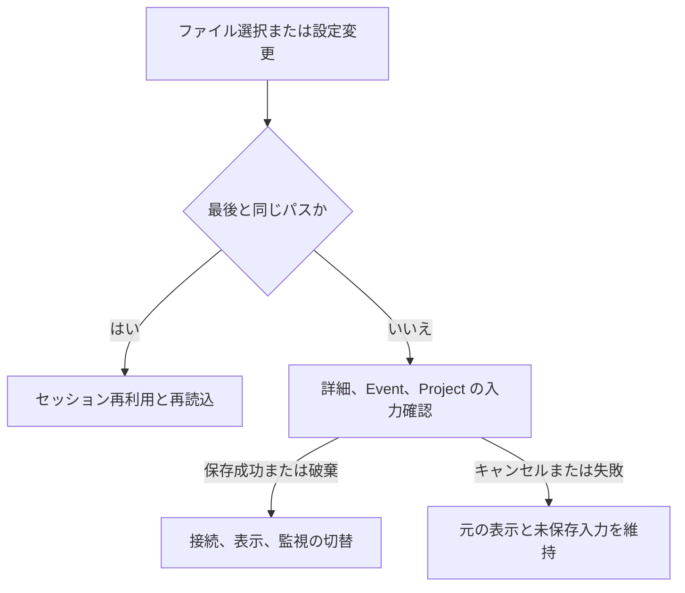

# 設計

## 背景と制約

- 提案: [proposal.md](proposal.md)
- 前提: openspec/tech.md の 参照と接続、レコード操作、起動と設定案内
- configure は設定変更ごとに新しい BoardSession を作り、初期 Event が下書きのある Event を置き換えていた。

## 設計判断

### D-01 - 最後の接続を保持する

- 選択: 設定解除後も最後のセッションを保持し、同じ正規化済み絶対パスへの再接続では再利用して再読込する。
- 理由: Project 参照と Event UUID の選択を保ち、同じ EventDetails の入力を維持できる。
- 代替案: 全接続のキャッシュは必要以上の寿命になるため使わず、画面から YAML へ選択を書き戻すこともしない。
- 昇格: openspec/tech.md の 再設定と入力保護

### D-02 - 接続確定前に入力を解決する

- 選択: 別パスへの変更は共有スキーマによる準備要求と結果応答を使い、詳細編集、Event の追加入力、Project の追加入力の順に既存の保存先へ保存、破棄、キャンセルを確認する。
- 理由: 初期 snapshot の適用を遅らせるだけでは保存要求の接続先が新しいファイルへ変わってしまう。
- 代替案: 設定後の無条件切替と暗黙の自動保存は、入力保護と利用者による保存判断を満たさない。
- 昇格: openspec/tech.md の 再設定と入力保護

承認から接続確定まで元の表示への新しい入力を一時停止し、確定または失敗の完了通知で解除する。\
切替先の欠落で前の接続を表示する場合は読取専用を維持し、新しい入力を復元時に失わないようにする。\
設定解除中は通常の保存を拒否し、確認中の明示的な保存だけ最後のセッションへ配送する。\
設定操作は直列化し、別ファイルへの切替中も元の監視を維持する。\
古いファイルの読込を待っている間の設定変更は、古い読込から待ちを切り離して新しい設定を判定する。\
左からの選択と新規作成は確認後に設定とファイルを変更し、設定画面からの変更を取り消した場合は直前の設定へ戻す。\
確認中に設定が変わった場合は古い要求で接続を確定しない。\
パネルを閉じた場合は保留中の接続要求を取り消し、応答待ちを残さない。

### D-03 - 接続を表示の識別子へ含める

- 選択: snapshot に管理ファイルの識別子を付け、別ファイルの確定時だけ Event、詳細と追加欄の状態を初期化する。
- 理由: 同じ Project 相対参照と UUID を使う別ファイルの入力や選択を混同しない。
- 代替案: UUID の全管理ファイル間一意性を要求することは、現在の保存モデルと整合しない。
- 昇格: openspec/tech.md の 再設定と入力保護

表示時の接続識別子を操作要求と左からの移動にも付け、切替後に遅れて到着した元の接続の操作を拒否する。\
識別子のない既存の内部呼出しは従来の操作スキーマで検証し、識別子がある場合は空文字や異なる接続を受け付けない。

## 検証計画

| シナリオID | 設計判断 | 検証方法 |
| --- | --- | --- |
| REQ-013-S01 | なし | 自動テスト |
| REQ-013-S02 | なし | 自動テスト |
| REQ-013-S03 | D-02、D-03 | 自動テスト |
| REQ-013-S04 | なし | 自動テスト |
| REQ-013-S05 | D-01、D-02、D-03 | 自動テスト |
| REQ-013-S06 | D-01、D-02、D-03 | 自動テスト |
| REQ-013-S07 | D-01、D-02、D-03 | 自動テスト |
| REQ-013-S08 | D-01、D-02、D-03 | 自動テスト |
| REQ-013-S09 | D-01、D-02、D-03 | 自動テスト |
| REQ-013-S10 | D-01、D-02、D-03 | 自動テスト |
| REQ-013-S11 | D-01、D-02、D-03 | 自動テスト |
| REQ-013-S12 | D-02、D-03 | 自動テスト |

既存 S01 から S04 は既存の処理と画面のテストを継続する。\
新規シナリオは実 BoardApp と実 Extension をつないだ処理の流れで検証し、共有スキーマの約束は共有部品で確認する。\
実ビルドを使うブラウザー確認では入力確認のつながりとフォーカスを検証する。\
新しい非機能要件と数値の調整はない。

## リスクと移行

設定イベントと左からの設定保存が重複しても直列に同じセッションへ接続し、確認と保存を重複させない。\
設定の復元そのものが失敗した場合は画面へエラーを返し、元の有効な表示を維持する。\
YAML の構造、コメントと UUID は変更せず、移行は不要である。\
同じパスの判定は字句的な絶対パス正規化とし、別のシンボリックリンク名は安全側に別接続として確認する。
