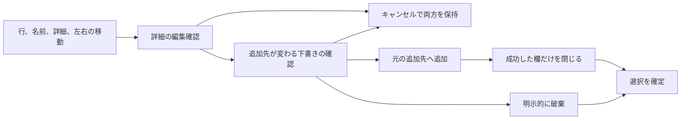

# 設計

## 背景と制約

提案は proposal.md、前提は openspec/tech.md の レコード操作である。\
既存の Task、Story の保存要求と世代番号を維持する。

## 設計判断

### D-01 - 確認と選択を分離する

- 選択: 名前と余白を共通の選択関数へ集める。ボードでは詳細編集の退出確認、追加先が変わる下書きの確認、選択の確定の順とする。単体部品でも同じ追加確認を使う。
- 理由: 選択要求の時点で cancelTask を呼ぶと、詳細の確認をキャンセルしても入力が消える。
- 代替案: 余白にも即時取消を追加するだけでは、名前側の下書き喪失が残る。
- 昇格: openspec/tech.md の レコード操作

### D-02 - 下書きへ追加先を束縛する

- 選択: 入力開始時に Event と任意 Story の修飾 ID を記録し、通常送信と移動前の送信の両方で使う。成功した欄だけを閉じ、失敗時は同じ追加先で再送する。Task と Story の両方がある場合も各成功を記録し、再送で成功済みを追加しない。
- 理由: 描画時の direct や story が変わっても要求先を転用しない。
- 代替案: 下書きを移動先へ自動移送すると、利用者が意図しない追加が起こる。
- 昇格: openspec/tech.md の レコード操作

## 検証計画

| シナリオID | 設計判断 | 検証方法 |
| --- | --- | --- |
| REQ-034-S01 | D-01 | 自動テスト |
| REQ-034-S02 | D-01 | 自動テスト |
| REQ-034-S03 | D-02 | 自動テスト |
| REQ-034-S04 | D-02 | 自動テスト |
| REQ-034-S05 | D-01、D-02 | 自動テスト |
| REQ-034-S06 | D-01 | 自動テスト |
| REQ-034-S07 | D-02 | 自動テスト |
| REQ-034-S08 | D-01 | 自動テスト |

既存の保存と世代の判断は部品で維持し、左右の要求と詳細の確認への接続は実 BoardApp で確認する。\
実ブラウザーでは実セッションと一時 YAML を使い、追加先の非変更と保存先を確認する。\
保存モデルと共有メッセージを変更しないため、旧データの移行はない。

## リスクと移行

詳細と追加の両方に未保存内容があれば、それぞれの確認が順に出る。\
途中でキャンセルしても、利用者が確定した保存や明示的に捨てた入力以外は残る。\
外部削除時の取消は既存のシナリオを維持する。
