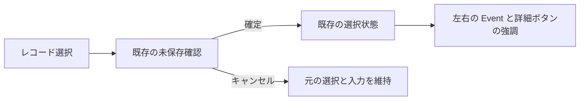

# 設計

## 背景と制約

- 提案: [proposal.md](proposal.md)
- 前提: openspec/product.md の 画面と操作、openspec/tech.md の レコード操作、色の入力

## 設計判断

### D-01 - 確定した選択を描画する

- 選択: 左の EventList へ既存の scopedEventSelection を渡す。タイムラインは既存の選択 Event を使い、同日マーカーは選択 Event を含む場合、同日一覧は対象の1行を強調する。下部の要約は表示中の Event を選択済みとする。
- 理由: 未保存確認を通った後の状態を使い、左右の先行した選択や別 Project の同じ UUID の混同を防ぐ。
- 代替案: クリック時の局所状態で先に色を変える方法は、キャンセルと確認中に表示がずれるため使わない。
- 昇格: openspec/tech.md の レコードの選択表現

### D-02 - 選択の詳細色を共通部品に置く

- 選択: DetailButton に任意の selected を渡し、選択時だけ既存 Story と同じテーマの選択前景を使う。背景の混色35%とフォーカス色の枠40%は Story の現在の値を新しい Event 表示でも使い、Story 自体の規則は変更しない。
- 理由: 未選択の補足ありの青と補足なしの灰色を維持し、ライトでは白へ固定せずテーマの濃い前景で判別できる。
- 代替案: 全詳細ボタンへ一律の白色を使う方法はライトで背景へ埋もれるため使わない。
- 昇格: openspec/tech.md の レコードの選択表現

### D-03 - 操作の見た目だけを調整する

- 選択: Project 名と Task 名のホバー下線を外し、Project の名前セルにポインターカーソルを適用する。既存のイベント処理、Story、完了とポイントの規則を保持する。名前のフォーカス枠が省略表示で欠ける Project では、セル内側にもキーボードのフォーカス枠を出す。
- 理由: リンクのような見た目を減らし、行の選択と独立した詳細ボタンを一貫させる。
- 代替案: クリックの処理を共通化し直す方法は今回の表示変更に不要である。
- 昇格: openspec/tech.md の レコードの選択表現

## 検証計画

| シナリオID | 設計判断 | 検証方法 |
| --- | --- | --- |
| REQ-026-S01 | D-02 | 自動テスト |
| REQ-026-S02 | D-02 | 自動テスト |
| REQ-026-S03 | D-02 | 自動テスト |
| REQ-026-S04 | D-02 | 自動テスト |
| REQ-035-S01 | D-01、D-03 | 自動テスト |
| REQ-035-S02 | D-02、D-03 | 自動テスト |
| REQ-035-S03 | D-01、D-02 | 自動テスト |
| REQ-035-S04 | D-02、D-03 | 自動テスト |

両テーマの選択、未選択、ホバーとキーボードのフォーカスを実描画で照合し、Story の状態別の算出スタイルを修正前後で比較する。\
詳細の保存、破棄、キャンセル、保存失敗と追加下書きの既存検査を再実行する。\
CSS の存在だけで判定せず、実色と下線の完全一致、操作回数、表示先と実 YAML を確認する。

## リスクと移行

選択色が危険色と完了の取り消し線を隠さないようにし、月の補助詳細を常時表示へ変えない。\
共有スキーマ、通信、YAML と UUID を変更せず、旧データの移行は不要である。\
補足の有無の色より選択時の詳細色を優先する。
