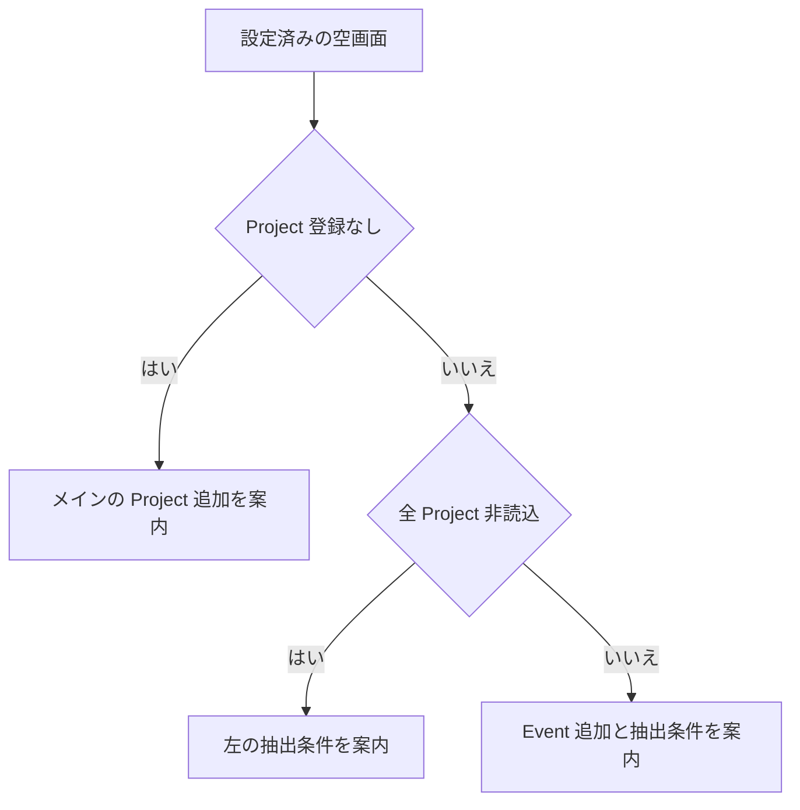

# 設計

## 背景と制約

- 提案: [proposal.md](proposal.md)
- 前提: openspec/tech.md の UI実装、レコード操作、テスト方針
- 観察: artifacts/ui-review/before/ に実ビルドの両テーマで見つけた問題を残した。

## 設計判断

### D-01 - 現在の行構造へ CSS を合わせる

- 選択: Event 行の選択ボタンだけを3列の grid にし、共通の詳細と全面選択ボタンへ広い button 規則を当てない。
- 理由: 旧 button.event-row の規則が現在の div 行に効かず、後続の event-row-select も詳細度で負けていた。
- 代替案: ボタンを入れ子へ戻すことは、独立した操作を損なうため行わない。
- 昇格: なし

共通の詳細ボタンには同じサイズと枠を定義し、左でも裸の小さなアイコンにならないようにする。

### D-02 - 状態の案内とエラーを共通化する

- 選択: shared/ui に空状態とエラーの部品を置き、両アプリで使う。空状態の判断は登録数、読込数、表示 Event の有無に絞る。
- 理由: 0件の理由と次の入口を明示し、左右で違う案内や未設定案内の重複を作らない。
- 代替案: 空状態へ新しい作成ボタンを増やすより、既存の入口を案内して操作体系を保つ。
- 昇格: openspec/tech.md の 状態の表示

エラーは本文を変えず、警告アイコン、テーマに沿う枠と背景、折り返しを共通部品で付ける。\
既存の role=alert と要求結果の処理を維持する。

### D-03 - 所属色と文字の読みやすさを分ける

- 選択: 設定色は枠へそのまま使い、タイトル文字は設定色30%、テーマ前景70%の color-mix にする。係数は app/style.css の .detail-title へ1か所で置く。
- 理由: 白、黒と淡色でもテーマ前景へ近づけて読め、設定色との関係も残る。
- 代替案: 保存色を自動変更することと、タイトルから所属色を完全に外すことは行わない。
- 昇格: openspec/tech.md の 状態の表示

実ビルドでは白、黒、淡色のタイトルを両テーマで測り、今回のテストの目安を背景とのコントラスト4.5以上とする。\
この目安は画面全体のアクセシビリティ適合を保証するものではない。

### D-04 - 実画面の検査をトレースへ含める

- 選択: trace.json の既存のテスト命名規則に、実際に実行する scripts/verify-*.mjs を加える。test:ui には主要な実ビルド検査をまとめる。
- 理由: DOM のみでは検出できなかった CSS の寸法と色の回帰を、実行根拠のあるテストとして追える。
- 代替案: jsdom で CSS の文字列を比較するテストは、実際のレイアウトを検証しないため採用しない。
- 昇格: openspec/tech.md の 状態の表示

### D-05 - 抽出条件の終了操作を合わせる

- 選択: Escape と枠外操作で閉じ、Escape では抽出条件ボタンへ戻す。
- 理由: 実操作で入口の再クリック以外に閉じられず、他の選択部品と終了操作が違っていた。
- 代替案: 条件の選択ごとに閉じる方法は、複数 Project の切替を妨げるため使わない。
- 昇格: なし

抽出条件の背景と枠は、menu 用のテーマ変数がない場合も editor と panel の変数へフォールバックし、透明にしない。

### D-06 - 密な月表示だけ補助操作を外へ出す

- 選択: 月の期限マーカーの詳細ボタンは通常透明にし、ホバーと focus-within でマーカーの上へ表示する。キーボードの順序はマーカー、詳細のまま保つ。
- 理由: 通常の30pxボタンと ◆ を狭い日付列に並べると重なる。列を広げて月全体の見通しを失うことを避ける。
- 代替案: 詳細操作を削除する方法と、先に選択してから別の入口へ移る方法は、操作数を増やすため行わない。
- 昇格: なし

### D-07 - 保存の成功を入力へ確定する

- 選択: 名前や補足と同時に色を保存した場合も、成功したパッチの色をコード入力へ反映する。
- 理由: 保存済み値と同色でも前後空白が残り、保存成功後も未保存表示になっていた。
- 代替案: どの snapshot 更新でも無条件に入力を上書きする方法は、別の未保存入力を消すため行わない。
- 昇格: openspec/tech.md の 色の入力

## 検証計画

| シナリオID | 設計判断 | 検証方法 |
| --- | --- | --- |
| REQ-042-S01 | なし | 自動テスト |
| REQ-042-S02 | なし | 自動テスト |
| REQ-042-S03 | なし | 自動テスト |
| REQ-042-S04 | D-07 | 自動テスト |
| REQ-042-S05 | D-07 | 自動テスト |
| REQ-042-S06 | D-07 | 自動テスト |
| REQ-042-S07 | D-07 | 自動テスト |
| REQ-016-S01 | なし | 自動テスト |
| REQ-016-S02 | D-06 | 自動テスト |
| REQ-016-S03 | なし | 自動テスト |
| REQ-016-S04 | なし | 自動テスト |
| REQ-016-S05 | D-06 | 自動テスト |
| REQ-016-S06 | D-06 | 自動テスト |
| REQ-019-S01 | なし | 自動テスト |
| REQ-019-S02 | なし | 自動テスト |
| REQ-019-S03 | D-01 | 自動テスト |
| REQ-019-S04 | D-01 | 自動テスト |
| REQ-020-S01 | なし | 自動テスト |
| REQ-020-S02 | なし | 自動テスト |
| REQ-020-S03 | なし | 自動テスト |
| REQ-020-S04 | D-05 | 自動テスト |
| REQ-014-S01 | なし | 自動テスト |
| REQ-014-S02 | D-02 | 自動テスト |
| REQ-014-S03 | D-02 | 自動テスト |
| REQ-026-S01 | なし | 自動テスト |
| REQ-026-S02 | なし | 自動テスト |
| REQ-026-S03 | D-03 | 自動テスト |
| REQ-026-S04 | D-03 | 自動テスト |
| REQ-043-S01 | D-02 | 自動テスト |
| REQ-043-S02 | D-02 | 自動テスト |
| REQ-043-S03 | D-02 | 自動テスト |
| REQ-043-S04 | D-02 | 自動テスト |

空状態とエラーの意味は部品と画面配線で確認し、寸法、重なり、色、クリック経路は実ビルドで確認する。\
既存シナリオのテストは変更せず、ブラウザーでの接続と全体操作を追加する。\
初期設定、カレンダー、削除取消、反復追加と保存失敗、両テーマ、一覧と各階層の詳細を観察する。

## リスクと移行

CSS の詳細度の修正が、詳細ボタンや余白の選択を覆わないことをクリック位置で確認する。\
空状態で新規 Project の作成を誤って勧めないことと、エラーの長いパスが狭いペインを広げないことを確認する。\
YAML、コメント、UUID とメッセージの保存契約は変えず、移行は不要である。
