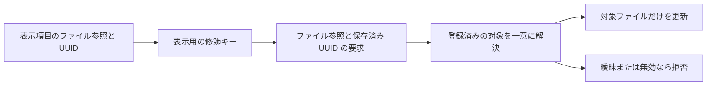

# 設計

## 背景と制約

提案は proposal.md、前提は openspec/tech.md の 実行境界と保存モデルである。

## 設計判断

### D-01 - 参照と接続の明示

- 選択: 登録されたファイル参照を Project の識別に用い、画面のキー、計算用 ID と操作メッセージへ一貫して含める。
保存対象の UUID は書き換えず、参照がない操作は全対象から一意に決まる場合だけ許可する。
- 理由: UUID だけの最初の一致や、開いているフォルダだけに依存しない。
- 代替案: UUID の全体一意化は正式仕様を変えるため採用しない。
- 昇格: openspec/tech.md の 参照と接続

## 検証計画

| シナリオID | 設計判断 | 検証方法 |
| --- | --- | --- |
| REQ-005-S01 | D-01 | 自動テスト |
| REQ-005-S02 | D-01 | 自動テスト |
| REQ-005-S03 | D-01 | 自動テスト |
| REQ-005-S04 | D-01 | 自動テスト |
| REQ-005-S05 | D-01 | 自動テスト |
| REQ-005-S06 | D-01 | 自動テスト |
| REQ-005-S07 | D-01 | 自動テスト |

保存は実セッションと一時ファイル、境界は共有スキーマ、画面の接続は部品、監視は実際の登録パターンで確認する。\
既存のシナリオは既存テストを維持し、追加境界が誤った振る舞いを検出することを確認する。

## リスクと移行

製品データの変更と旧データ移行は行わない。\
対象を特定できない要求は変更せず拒否する。
