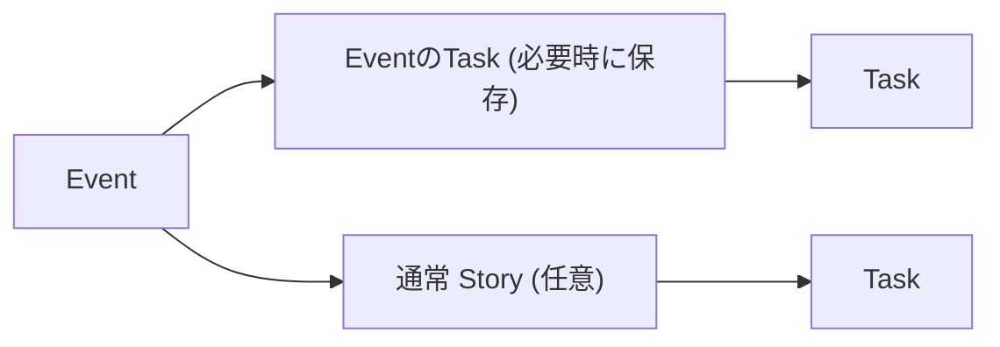

# 設計

## 背景と制約

- 提案: [proposal.md](proposal.md)
- 前提: openspec/tech.md の 実行境界、データ保存、互換性の判断基準。
- 元実装では EventDetails が Event オブジェクト更新ごとに選択と入力を初期化し、詳細フォームは保存結果を待たずに閉じる。

## 設計判断

### D-01 - 保存階層を維持して Story を任意にする

- 選択: `isDefault: true` の Story を最初の Event Task 保存時に作り、後続は同じ ID へ追加する。
  表示名は「EventのTask」を共通定数に置く。
  Event に直接 `tasks` を追加する形式は採用しない。
- 理由: 既存の集計、削除、完了、編集が同じ階層を処理でき、旧版でも Task を失わない。
- 代替案: 必須 Story の自動生成は空データを増やし、名前判定では同名の旧 Story を転用してしまう。
- 昇格: openspec/tech.md の 互換性の判断基準

### D-02 - 編集状態と保存済み状態を分ける

- 選択: 同じ Event ID のスナップショット更新では選択と入力を保持し、対象消失時だけ取り消す。
  保存結果を await し、操作世代を照合して取消後の遅い応答で新しい入力を消さない。
  セッションの変更要求を順次処理し、連続した YAML 更新の取りこぼしを防ぐ。
- 理由: ファイル監視による再配信や繰り返し操作のたびに下書きを失わない。
- 代替案: オブジェクトの参照変化で初期化する現状では通常操作でも選択が戻る。
- 昇格: openspec/tech.md の 互換性の判断基準

### D-03 - 名前と共通部品で導線を統一する

- 選択: Project、Event、Task 名を標準 button にする。
  Story は選択を保持し、詳細ボタンを独立させる。
  ボードにも InlineAdd の Event 追加を置き、作成した Event の Task に進めるよう保存後に選択する。
  共通の枠、角丸、フォーカスを CSS 変数にまとめ、詳細の一時操作は Esc を局所で処理する。
- 理由: 名前から1操作で目的の詳細へ到達し、追加と取消の学習を共有できる。
- 代替案: 全行クリックはチェック、ポイント、並べ替えとの誤操作を増やす。
- 昇格: なし

### D-04 - 画面縮小時にも分割下限を再計算する

- 選択: 既存 BoardSplit の下限判定を共有し、ResizeObserver でも適用する。
  既存値の上下80px、極小時40%を単一の定数へまとめる。
- 理由: 元リポジトリの WARNING W-01 を解消し、操作領域を確保する。
- 代替案: 最初の比率を維持すると片方の操作が見切れる。
- 昇格: なし

## 検証計画

| シナリオID | 設計判断 | 検証方法 |
| --- | --- | --- |
| REQ-033-S01 | D-01 | 自動テスト |
| REQ-033-S02 | D-01 | 自動テスト |
| REQ-033-S03 | D-01 | 自動テスト |
| REQ-033-S04 | D-01 | 自動テスト |
| REQ-034-S01 | D-02 | 自動テスト |
| REQ-034-S02 | D-02 | 自動テスト |
| REQ-034-S03 | D-02 | 自動テスト |
| REQ-034-S04 | D-02 | 自動テスト |
| REQ-035-S01 | D-03 | 自動テスト |
| REQ-036-S01 | D-02、D-03 | 自動テスト |
| REQ-036-S02 | D-02、D-03 | 自動テスト |
| REQ-036-S03 | D-02、D-03 | 自動テスト |
| REQ-037-S01 | D-03 | 自動テスト |
| REQ-037-S02 | D-03 | 自動テスト |

| REQ-018-S01 | D-01 | 自動テスト |
| REQ-018-S02 | D-01 | 自動テスト |
| REQ-018-S03 | D-01 | 自動テスト |
| REQ-018-S04 | D-01 | 自動テスト |
| REQ-031-S01 | D-04 | 自動テスト |
| REQ-031-S02 | D-04 | 自動テスト |
| REQ-031-S03 | D-04 | 自動テスト |
| REQ-031-S04 | D-04 | 自動テスト |
| REQ-031-S05 | D-04 | 自動テスト |
| REQ-031-S06 | D-04 | 自動テスト |

永続化はセッションとファイルの流れ、表示状態は部品、追加導線はアプリで確認する。\
実ビルドのブラウザー検証は部品の接続と反復操作を確認し、同じ判断の網羅を重ねない。\
REQ-031-S03 の既存不具合は最小高さに調整してから画面を縮小する順番で回帰確認する。\
性能式と稼働日境界は変更しないため、既存テストを維持する。\
VS Code 実機の最終操作は依頼どおり利用者が行い、manual-checks.md に手順を残す。

## リスクと移行

旧データを一括変換しない。\
専用 Story の属性は旧版には無視されるが、既存の4階層を保持するため Task は読める。\
同じ Event に複数の専用 Story を手書きした場合は検証エラーとし、曖昧な追加先へ保存しない。\
試用前に管理データを Git コミットまたは別コピーへ保存し、戻す場合はそのコピーを使う。\
追加済み Task を通常 Story に移す UI は対象外である。
