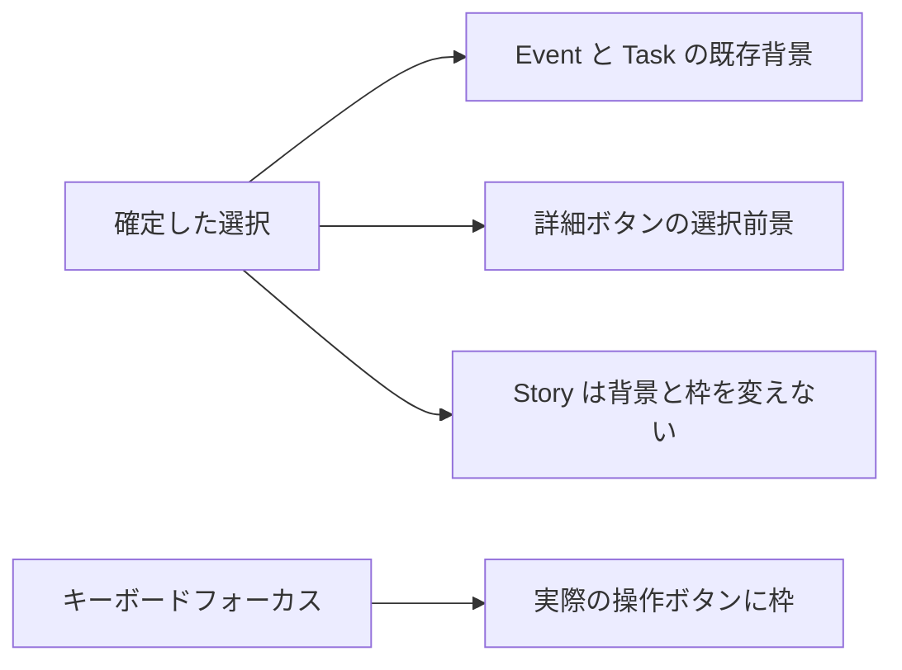

# 設計

## 背景と制約

- 提案: [proposal.md](proposal.md)
- 前提: openspec/product.md の 画面と操作、openspec/tech.md の レコードの選択表現とテスト方針。
- 現行は選択時の行 outline と、子ボタンの focus-visible が別に存在する。Task の focus-within にも行 outline がある。
- 共有スキーマ、通信、YAML コメントと ID、選択と編集確認の処理は変更しない。

## 設計判断

### D-01 - 選択枠とフォーカス枠を分離する

- 選択: Event の4表示箇所と Story の選択 outline を削除し、Task の focus-within から行 outline だけを削除する。各操作ボタンと record-hitbox の focus-visible は維持する。
- 理由: マウスで選択した後の focus-within を選択枠として残さず、キーボード操作では実際の操作対象に枠を示せる。
- 代替案: focus-within の枠を残すとクリック後も選択枠が残る。すべての outline を一括で無効にするとフォーカスを失うため採用しない。
- 昇格: openspec/tech.md の レコードの選択表現。

### D-02 - 背景と詳細強調を独立させる

- 選択: Story の選択背景だけを削除し、選択前景と詳細ボタンの強調を維持する。Event と Task の既存背景は変更しない。
- 理由: 最新の指定が以前の Story 表現の維持に優先するためである。
- 代替案: 全階層の背景を統一すると、Event と Task の背景維持の指定に反する。
- 昇格: openspec/tech.md の レコードの選択表現。

選択は背景と詳細前景へ、キーボードフォーカスは操作ボタンの枠へ、それぞれ反映する。

### D-03 - 新 UI の実画面へ差し替える

- 選択: 既存の隔離した実 VS Code 撮影を再実行して5枚を再取得し、フォント13px、倍率0、Default Dark Modern と共通85%表示を維持する。
- 理由: README の見本と製品の選択表示を一致させる。調整値の定義先は既存の撮影スクリプトと prepare-docs.mjs の readmeImageScale のままとする。
- 代替案: 既存画像の枠だけを加工すると実画面と異なるため採用しない。
- 昇格: なし。

## 検証計画

| シナリオID | 設計判断 | 検証方法 |
| --- | --- | --- |
| REQ-030-S01 | なし | 自動テスト |
| REQ-030-S02 | D-01、D-02 | 自動テスト |
| REQ-035-S01 | D-01、D-02 | 自動テスト |
| REQ-035-S02 | D-01 | 自動テスト |
| REQ-035-S03 | D-01、D-02 | 自動テスト |
| REQ-035-S04 | D-01、D-02 | 自動テスト |
| REQ-035-S05 | D-01 | 自動テスト |

表示は実ビルドを使う両テーマの Chromium で計算済みスタイルと画面を確認する。\
選択前後、ホバー、マウスフォーカス、キーボードフォーカスを分け、行だけでなく名前と余白の操作ボタンも確かめる。\
保存、破棄、キャンセル、独立操作は既存の処理の流れの検査を継続する。\
予測と進捗の既存の判断は現在の部品テストを再実行し、同じ計算を上位で重複検査しない。\
追加の異常入力とデータ境界は表示だけの変更なので該当しない。\
製品全体の最終実機確認は既存台帳を未確認のまま更新し、今回のブラウザー確認と実画面撮影で完了扱いにしない。

## リスクと移行

Story の背景をなくすことで選択が弱くなるため、詳細ボタンの強調と選択による Task 表示の追従を回帰検査する。\
Event と Task の背景は変更前の値との比較で維持を確認する。\
保存データの移行はなく、戻す場合はスタイルと文書、画像を同じ変更単位で戻せる。
