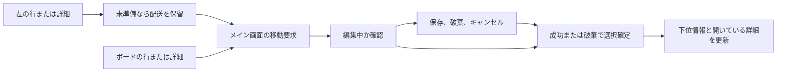

# 設計

## 背景と制約

提案は proposal.md、前提は openspec/tech.md の 保存モデルと参照と接続である。\
Event.tasks を表す仮想グループを Taks と表示し、保存 Story の追加や変換は行わない。

## 設計判断

### D-01 - 選択と詳細を同じ入口へ集める

- 選択: ボードで階層を含むレコード選択を管理し、詳細ボタンは選択と表示を1回で行う。独立操作のバブリングを遮断する。
- 理由: 行、名前とボタンで異なる選択や誤った対象を作らない。
- 代替案: 名前だけで詳細を開く旧操作は依頼に反する。
- 昇格: openspec/tech.md の レコード操作

### D-02 - 編集保護を移動の前に行う

- 選択: 詳細パネルへ退出要求を渡し、編集中は保存、破棄、キャンセルの確認を行う。左ペインは検証済みのナビゲーションをメイン画面へ配送し、メイン画面が選択の確定を送る。未準備のメイン画面へは最新要求を保留し、ready 後に配送する。
- 理由: Extension 側で先に選択を変えると、未保存の入力が失われる。
- 代替案: ブラウザーの confirm は保存操作と失敗からの再送を表現できない。
- 昇格: openspec/tech.md の レコード操作

### D-03 - 寸法とポイントの共通化

- 選択: 列幅240px、最小180px、最大480px、行高56px、最小44px、最大120px、操作刻み8pxを widgets/timeline/model/dimensions.ts の1か所に置く。画面幅から日付操作用の領域を確保する。寸法を Webview 状態に保存し、調整境界はポインターとキー、Home、ダブルクリック、Esc に対応する。Task のポイント部品を shared へ移す。
- 理由: 初期行高を少し広げ、全行の整列と小画面の到達性を維持する。詳細と一覧で同じ部品を使い操作と色の差をなくす。
- 代替案: YAML に寸法を保存すると製品データを不要に変更する。
- 昇格: openspec/tech.md の レコード操作

## 検証計画

| シナリオID | 設計判断 | 検証方法 |
| --- | --- | --- |
| REQ-016-S01 | D-01、D-02、D-03 | 自動テスト |
| REQ-016-S02 | D-01、D-02、D-03 | 自動テスト |
| REQ-016-S03 | D-01、D-02、D-03 | 自動テスト |
| REQ-016-S04 | D-01、D-02、D-03 | 自動テスト |
| REQ-016-S05 | D-01、D-02、D-03 | 自動テスト |
| REQ-037-S01 | D-01、D-02、D-03 | 自動テスト |
| REQ-037-S02 | D-01、D-02、D-03 | 自動テスト |
| REQ-040-S01 | D-01、D-02、D-03 | 自動テスト |
| REQ-040-S02 | D-01、D-02、D-03 | 自動テスト |
| REQ-021-S01 | D-01、D-02、D-03 | 自動テスト |
| REQ-021-S02 | D-01、D-02、D-03 | 自動テスト |
| REQ-033-S01 | D-01、D-02、D-03 | 自動テスト |
| REQ-033-S02 | D-01、D-02、D-03 | 自動テスト |
| REQ-033-S03 | D-01、D-02、D-03 | 自動テスト |
| REQ-033-S04 | D-01、D-02、D-03 | 自動テスト |
| REQ-033-S05 | D-01、D-02、D-03 | 自動テスト |
| REQ-026-S01 | D-01、D-02、D-03 | 自動テスト |
| REQ-026-S02 | D-01、D-02、D-03 | 自動テスト |
| REQ-026-S03 | D-01、D-02、D-03 | 自動テスト |
| REQ-035-S01 | D-01、D-02、D-03 | 自動テスト |
| REQ-036-S01 | D-01、D-02、D-03 | 自動テスト |
| REQ-036-S02 | D-01、D-02、D-03 | 自動テスト |
| REQ-036-S03 | D-01、D-02、D-03 | 自動テスト |
| REQ-041-S01 | D-01、D-02、D-03 | 自動テスト |
| REQ-041-S02 | D-01、D-02、D-03 | 自動テスト |
| REQ-041-S03 | D-01、D-02、D-03 | 自動テスト |
| REQ-041-S04 | D-01、D-02、D-03 | 自動テスト |
| REQ-012-S01 | D-01、D-02、D-03 | 自動テスト |
| REQ-012-S02 | D-01、D-02、D-03 | 自動テスト |

既存シナリオは下層のテストを継続し、変更した選択と編集保護は部品とアプリの操作、配送は Extension の接続で確認する。\
実ビルドでは両テーマの接続と描画寸法、反復操作を確認する。\
YAML と UUID、コメントは変更しないため移行テストは不要であり、既存の実保存回帰を維持する。

## リスクと移行

自動 Story という表現は現行の仮想グループに対応させる。\
保存の失敗、画面の未準備、選択中項目の外部削除を考慮し、未保存入力を保持する。\
旧操作の仕様とテストは新しい操作へ更新し、製品データの移行はない。
