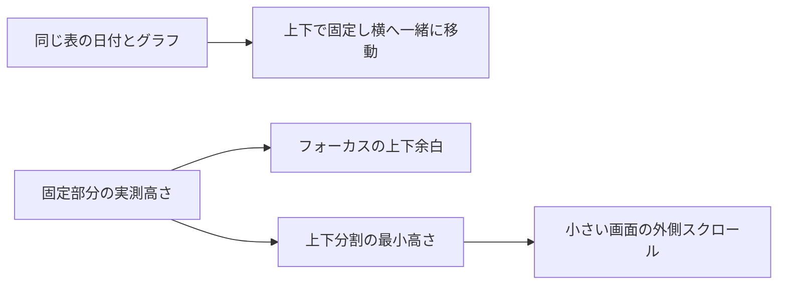

# 設計

## 背景と制約

- 提案: [proposal.md](proposal.md)
- 前提: openspec/product.md の 画面と操作、openspec/tech.md の テスト方針。
- グラフは同じ表の末尾にあり、日付列へ自然に揃っている。既存の日付固定と上下境界操作を維持する。

## 設計判断

### D-01 - 同じ表の固定フッター

- 選択: グラフ行をtfootへ移し、各セルをbottom:0のstickyにする。不透明なテーマ背景と上側の区切りを使い、最大値ラベルを含む領域を確保する。
- 理由: 日付と列幅を別計算せず、横スクロールで同じ量だけ動かせる。
- 代替案: 独立した表では幅とスクロールの同期が増える。
- 昇格: なし。

### D-02 - 固定部分を除いた操作領域

- 選択: 日付とグラフの実高さをResizeObserverで測り、scroll-paddingの上下と最小上部高さへ反映する。BoardSplitへ最小上部高さを渡し、少なくとも行操作の最小高さを残す。全体が収まらない場合はボードの最小高さを確保して外側をスクロール可能にする。
- 理由: 80pxの領域に固定部分を重ねず、文字サイズや狭幅でも操作へ到達できる。
- 代替案: グラフや日付を隠すと常時表示の要求を満たさない。
- 昇格: なし。

## 検証計画

| シナリオID | 設計判断 | 検証方法 |
| --- | --- | --- |
| REQ-031-S01 | D-02 | 自動テスト |
| REQ-031-S02 | D-02 | 自動テスト |
| REQ-031-S03 | D-02 | 自動テスト |
| REQ-031-S04 | D-02 | 自動テスト |
| REQ-031-S05 | D-02 | 自動テスト |
| REQ-031-S06 | D-02 | 自動テスト |
| REQ-031-S07 | D-02 | 自動テスト |
| REQ-046-S01 | D-01 | 自動テスト |
| REQ-046-S02 | D-01 | 自動テスト |
| REQ-046-S03 | D-01、D-02 | 自動テスト |

既存の分割操作検査を維持し、実ビルドで縦横位置、最小高さとフォーカスを確認する。\
実VS Codeの両テーマもスクロールして確認する。

## リスクと移行

極端な小画面ではボード全体の縦スクロールが加わる。\
表の固定部分を重ねず、下部の作業にも到達できることを優先する。\
保存と計算は変更しない。
