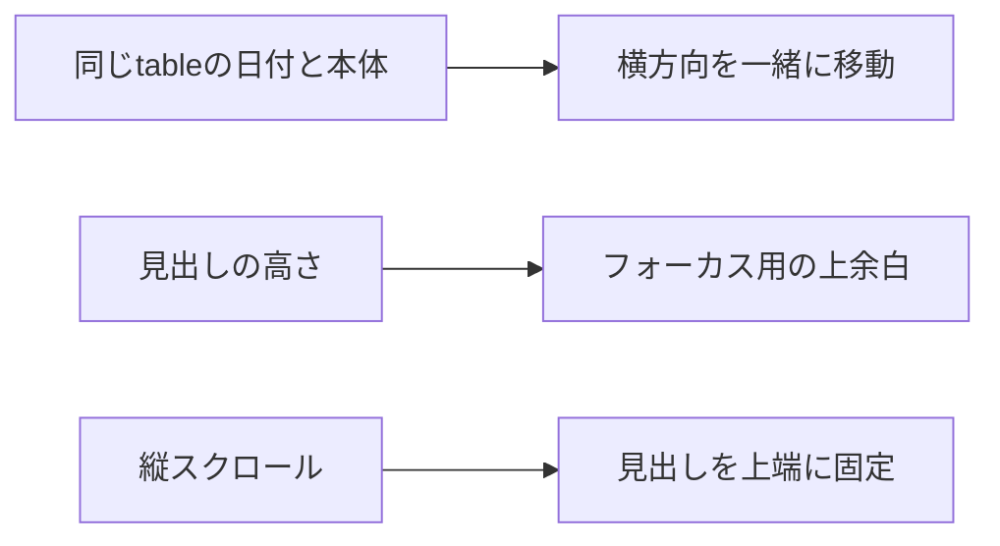

# 設計

## 背景と制約

- 提案: [proposal.md](proposal.md)
- 前提: openspec/tech.md の レコード操作とテスト方針。
- 表はtimeline-panelの中にあり、日付と本体は同じtableの列を使う。

## 設計判断

### D-01 - 同じ表の見出しを固定する

- 選択: 各見出しセルをstickyで上端に固定し、不透明なテーマ背景を使う。日付の休日と今日の背景を維持する。狭幅で期間操作を指標が覆わないよう上部ヘッダーと指標を折り返す。見出しを行のハンドルより前面へ置く。
- 理由: 列幅を別計算せず、横スクロールと寸法操作に追従できる。
- 代替案: 表を分割すると列のずれと操作状態の同期が必要になる。
- 昇格: なし。

### D-02 - フォーカスを見出しの下へ収める

- 選択: 見出し高さをResizeObserverでスクロール領域へ伝え、scroll-padding-topに反映する。
- 理由: 文字サイズと寸法変更後もキーで到達した操作を見出しの下に表示できる。
- 代替案: 固定pxでは文字サイズの変更に追従できない。
- 昇格: なし。

## 検証計画

| シナリオID | 設計判断 | 検証方法 |
| --- | --- | --- |
| REQ-044-S01 | D-01 | 自動テスト |
| REQ-044-S02 | D-01、D-02 | 自動テスト |
| REQ-044-S03 | D-01、D-02 | 自動テスト |

実ビルドでスクロールと座標、操作可能性を測り、両テーマの画面を保存する。

## リスクと移行

保存形式の変更はない。\
見出しの重なりは意図した遮蔽だけに限定し、フォーカスした行を隠さない。
