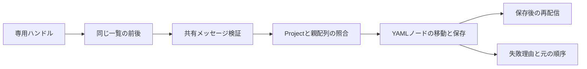

# 設計

## 背景と制約

- 提案: [proposal.md](proposal.md)
- 前提: openspec/product.md の 管理データと画面と操作、openspec/tech.md の レコード操作とYAML保存。
- StoryはEvent.stories、TaskはEvent.tasksまたはStory.tasksで順序を持つ。Taksは画面だけの仮想行である。

## 設計判断

### D-01 - 同じ配列だけを移動する

- 選択: moveStoryとmoveTaskにProjectファイル、Event、Storyの親識別と移動元、移動先、前後を渡す。Sessionで最新のProjectを解決し、保存部品で親配列の両IDを照合する。
- 理由: Project内のID一意性とファイル単位の識別を守り、遅延した要求でも所属を変更しない。
- 代替案: 任意の行への移動では意図しない所属変更が起きる。
- 昇格: openspec/tech.md の レコード操作。

### D-02 - Projectと揃えた専用ハンドル

- 選択: 同じ記号、カーソル、前後の線と上下キーを使う。RecordSurfaceへ行のドラッグ属性を渡し、選択ボタンとは兄弟にする。Taksにハンドルとドロップ対象を設けない。スコープが変わったらドラッグを破棄し、外部と異種のドラッグを受け付けない。
- 理由: 既存の操作を維持し、追加下書きや詳細の移動確認を起動しない。
- 代替案: 行全体をdraggableにすると文字選択と詳細操作に干渉する。
- 昇格: なし。

### D-03 - 保存完了後だけ配信する

- 選択: YAMLSeqのノードを移動し、既存の一時ファイルとrenameによる保存方式を使う。Sessionの直列キューで保存してから再配信する。UIは楽観的な順序変更をせず、保存中は同じ一覧のハンドルを無効にし、失敗後は解除する。
- 理由: コメントとID、選択と詳細編集を保ち、保存失敗の巻き戻しを不要にする。
- 代替案: JSONからの再生成はコメントを失う。
- 昇格: なし。

## 検証計画

| シナリオID | 設計判断 | 検証方法 |
| --- | --- | --- |
| REQ-045-S01 | D-02、D-03 | 自動テスト |
| REQ-045-S02 | D-02、D-03 | 自動テスト |
| REQ-045-S03 | D-01、D-02 | 自動テスト |
| REQ-045-S04 | D-02 | 自動テスト |
| REQ-045-S05 | D-03 | 自動テスト |
| REQ-045-S06 | D-02、D-03 | 自動テスト |
| REQ-045-S07 | D-01、D-03 | 自動テスト |

保存の意味は最下層、操作と干渉は部品、通信のつながりと座標は実ビルド、両テーマと実保存は実VS Codeで検証する。

## リスクと移行

配列の順序以外は変更しない。\
Taksは名前を変えず固定とし、その中の直接Taskは並べ替えできる。\
保存形式、IDと所属の移行はない。
