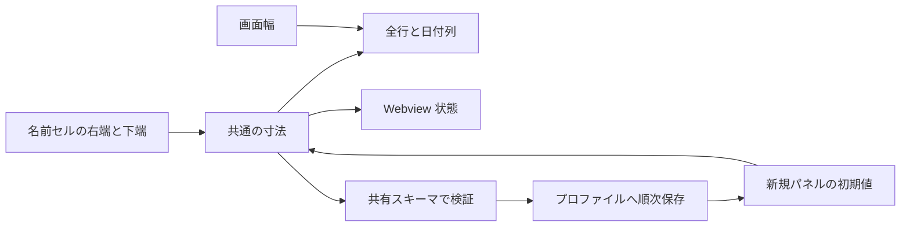

# 設計

## 背景と制約

- 提案: [proposal.md](proposal.md)
- 前提: openspec/product.md の 画面と操作、openspec/tech.md の レコード操作とテスト方針。
- 直前の既定幅280pxを維持する。既存の寸法は Webview の timelineLayout にあり、タブを閉じると失われることを実機で確認済みである。

## 設計判断

### D-01 - セル端の独立した操作

- 選択: 名前セルの右端と下端に separator を置き、見出しに端の意味を案内する。スライダーは削除する。ポインターの伝播と既定動作を止め、詳細と並べ替えのボタンを覆わない。
- 理由: 見ているセルを直接調整し、通常の行操作を維持できる。
- 代替案: セル全体のドラッグは選択と並べ替えを区別できない。
- 昇格: なし。

### D-02 - 共通の寸法と取消

- 選択: TimelineFrame の共通状態と Context を全境界から使う。単一の pointerId を捕捉し、開始時の寸法へ戻せるようにする。通常の解放では最後の座標も反映して確定し、Esc、pointercancel、lostpointercapture、フォーカス喪失ではドラッグを取り消す。キーによる変更はフォーカスが外れると確定する。
- 理由: 全行、日付、表示値と保存値を一致させ、解放後の移動や別ポインターを無視する。
- 代替案: セル単位の状態は共通寸法を維持できない。
- 昇格: openspec/tech.md の レコード操作。

### D-03 - 行高の追従と制限

- 選択: 下端の移動距離を対象行までの Project 数で割り、共通行高へ丸めて反映する。寸法は既存の model/dimensions.ts の定義を使い、幅180〜480、既定280、行高44〜120、既定56、キーの刻み8、日付領域180を維持する。
- 理由: 後続行でもつかんだ境界がポインターから離れず、画面縮小で保存幅を失わない。
- 代替案: 移動距離をそのまま行高へ足すと、後続行の境界はポインターより速く動く。
- 昇格: なし。

### D-04 - 保存済み寸法の引き継ぎ

- 選択: 現在の Webview 状態を優先して読み、既存値をプロファイルの globalState へ保存する。新規パネルには検証済みの初期値を HTML の数値データとして渡す。更新は共有スキーマを通し、順番に保存する。表示設定専用の結果メッセージで最新要求の失敗だけを表示し、他の編集エラーを消さない。
- 理由: 既存利用者の値と YAML を変えず、タブを閉じた後や VS Code 再起動でも戻せる。
- 代替案: Webview 状態だけでは新しいパネルへ値を渡せない。YAML に UI 設定を混ぜると製品データを変更する。
- 昇格: openspec/tech.md の レコード操作。

## 検証計画

| シナリオID | 設計判断 | 検証方法 |
| --- | --- | --- |
| REQ-040-S01 | D-02、D-04 | 自動テスト |
| REQ-040-S02 | D-02、D-03 | 自動テスト |
| REQ-040-S08 | D-01、D-02 | 自動テスト |
| REQ-040-S09 | D-01、D-03 | 自動テスト |
| REQ-040-S10 | D-02 | 自動テスト |
| REQ-040-S11 | D-01、D-02 | 自動テスト |
| REQ-040-S12 | D-01、D-03 | 自動テスト |
| REQ-040-S13 | D-04 | 自動テスト |

イベントの境界と取消は部品、保存値の検証は共有部品、保存と新規パネルの接続は Extension で確かめる。\
実ビルドでは列の位置、実ポインター、入力との接続、狭幅と表示復元を確かめ、同じ判断を各層で網羅し直さない。\
実 VS Code の両軸のドラッグと両テーマは補助確認とし、正式な最終操作確認は利用者が行う。

## リスクと移行

右端は左右キー、下端は上下キーを使い、Home とダブルクリックで既定値、Esc で取消にする。\
共通操作のタブ停止を増やしすぎないよう、見出しの右端と最初の Project の下端を Tab で到達できる代表とし、他の境界もポインターでフォーカスできるようにする。\
既存の Webview 保存値を優先し、設定幅の縮小は表示だけに適用する。\
既存の共有メッセージを追加するが、YAML のコメント、ID と内容の移行はない。
