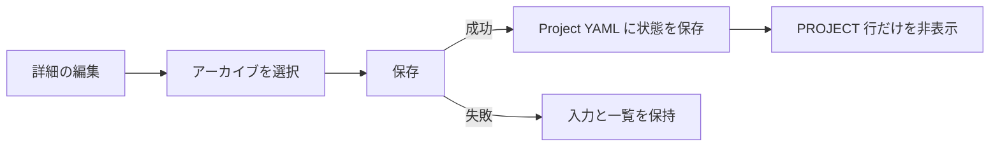

# 設計

## 背景と制約

- 提案: [proposal.md](proposal.md)
- 前提: openspec/product.md の 管理モデル、画面と操作、負荷と危険の基本原則、openspec/tech.md の データ保存、参照と接続、レコード操作。
- 既存の load は全表示と計算を外すため、一覧だけを片付ける今回の目的に流用しない。

## 設計判断

### D-01 - 表示対象だけを分ける

- 選択: Project の任意の真偽値 archived を共有スキーマへ加える。Timeline 内で行だけを除外し、並べ替えの隣接判定と高さ変更の行番号も表示中の配列を使う。全データを BoardApp と計算、EVENT 一覧へ引き続き渡す。
- 理由: 選択、追加下書きと計算を変えず、アーカイブと読み込み対象を独立させる。全件アーカイブでも見出し、追加と必要ペースを残す。
- 代替案: load を false にすると全データが表示と集計から消え、既存の読込設定に再表示の操作があるため採用しない。
- 昇格: openspec/tech.md の データ保存。

### D-02 - 既存の編集保存を使う

- 選択: 未アーカイブの Project の名前編集フォームへチェック欄と影響の説明を置く。保存するまで局所状態とし、チェックした場合だけ editItem.patch.archived: true を送る。通信境界では true だけを許可し、Project 以外への指定を拒否する。アーカイブ済みの詳細は読み取り専用の状態表示とし、復元操作は設けない。
- 理由: 保存失敗と移動確認の仕組みを共用し、取消後に再編集すると未チェックに戻せる。保存成功まで一覧を楽観的に除外しない。
- 代替案: 即時保存のスイッチは編集取消と操作意図が一致しないため採用しない。
- 昇格: なし。

### D-03 - YAML と対象の保全

- 選択: 登録ファイルと UUID で対象を解決する既存経路から YAML ノードの archived だけを変更し、一時ファイルと rename で保存する。管理ファイルと他 Project を変えず、既存ファイルの省略属性も読み込みだけでは補わない。
- 理由: コメント、未知の属性と子データを維持し、別 Project の同一 UUID も区別する。
- 代替案: オブジェクト全体の再生成は無関係のコメントを失うため採用しない。
- 昇格: なし。

## 検証計画

| シナリオID | 設計判断 | 検証方法 |
| --- | --- | --- |
| REQ-047-S01 | D-01、D-02、D-03 | 自動テスト |
| REQ-047-S02 | D-01、D-03 | 自動テスト |
| REQ-047-S03 | D-02 | 自動テスト |
| REQ-047-S04 | D-02、D-03 | 自動テスト |
| REQ-047-S05 | D-01、D-02 | 自動テスト |

S02 は共有スキーマと保存境界、S03 と S04 は詳細部品、S01 と S05 は接続した画面の流れで確かめる。\
上位の実 VS Code 検査は両テーマで表示と保存、再起動の接続を確認する。\
復元の境界は UI の不在で確認し、新たな性能要件と値の調整はない。

## リスクと移行

一覧から消えても EVENT と集計に残ることを編集欄と README に明記する。\
既存の Project は属性省略のまま読み込め、移行作業は不要である。\
実データは触らず一時ディレクトリのサンプルだけで検証する。
