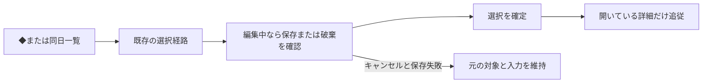

# 設計

## 背景と制約

- 提案: [proposal.md](proposal.md)
- 前提: openspec/product.md の 画面と操作、openspec/tech.md の レコード操作とレコードの選択表現、openspec/structure.md の 利用者向け文書と配布。
- PROJECT 名列の詳細は色の編集とアーカイブの入口でもあるため、日付の領域と区別する。

## 設計判断

### D-01 - 日付領域だけを簡素化する

- 選択: 単独 Event の marker-wrap と同日 marker-list の DetailButton を取り除き、それだけに使う月表示と位置の CSS も削除する。Project のボタン、マーカー、一覧の option、選択の配色とラベルは維持する。
- 理由: 見えない補助操作と Tab 移動先を残さず、既存の Project 操作へ到達できる。
- 代替案: CSS で隠すだけでは DOM と操作経路が残るため採用しない。PROJECT 名列まで削除する案は編集の入口を失うため採用しない。
- 昇格: openspec/tech.md の レコードの選択表現。

### D-02 - 選択と保存の経路を維持する

- 選択: ◆と option の onSelect から既存の chooseRecord と詳細の requestLeave を使い、通信と保存の実装は変えない。閉じた詳細は選択だけで開かず、開いた詳細は未保存確認後に追従する。
- 理由: 保存、破棄、キャンセル、保存失敗と Project ファイルを含む対象識別を変えない。
- 代替案: 名前や◆から無条件に詳細を開く操作への変更は依頼の範囲を超えるため採用しない。
- 昇格: なし。

## 検証計画

| シナリオID | 設計判断 | 検証方法 |
| --- | --- | --- |
| REQ-016-S01 | D-01、D-02 | 自動テスト |
| REQ-016-S02 | D-01 | 自動テスト |
| REQ-016-S03 | D-01 | 自動テスト |
| REQ-016-S04 | D-01 | 自動テスト |
| REQ-016-S05 | D-01 | 自動テスト |
| REQ-016-S06 | D-01、D-02 | 自動テスト |
| REQ-035-S01 | D-01、D-02 | 自動テスト |
| REQ-035-S02 | D-01 | 自動テスト |
| REQ-035-S03 | D-01、D-02 | 自動テスト |
| REQ-035-S04 | D-01 | 自動テスト |
| REQ-035-S05 | D-01、D-02 | 自動テスト |

ボタンの不在と表示期間は Timeline 部品、未保存確認と送信対象は BoardApp の接続で確認する。\
既存の表示、選択、並べ替えとフォーカスは既存の部品、ブラウザー検査を維持する。\
実 VS Code の両テーマでは日付領域と残した詳細操作、狭い月表示を確認し、README を同じ撮影条件で更新する。\
保存形式、通信境界、YAML コメントと ID は変更しないため、既存の全体検査で回帰を確かめる。\
新たな調整値と性能要件はない。

## リスクと移行

「タイムライン」を上部全体と解釈すると Project 編集の入口を失うため、日付セルと同日一覧に範囲を限定し、README に残る入口を記す。\
管理データの移行は不要であり、実データを使わず一時サンプルで検証する。
