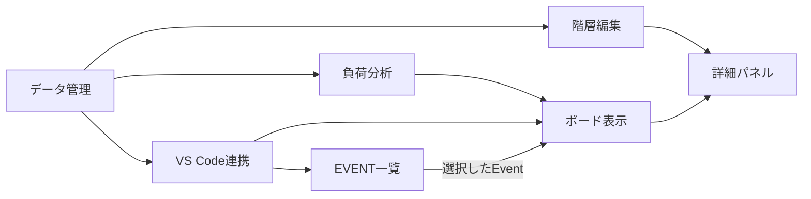

# 仕様の読み方

このディレクトリには、GlitchBoardの機能ごとの正式仕様を置く。\
各`spec.md`の`Purpose`は機能の目的、`Requirements`は満たすべき振る舞い、`Scenario`は具体的な確認例を示す。\
製品全体の目的と用語は[product.md](../product.md)、仕様と実装・テストの対応は[traceability.md](../traceability.md)を参照する。\
進行中の変更がある場合は[changes](../changes)配下の差分仕様も確認する。

## 全体像

管理データを負荷分析と画面表示で共有し、画面からの操作を管理データへ反映する。\
以下は機能を理解するための関係であり、実装の呼び出し順を示すものではない。

`data-management`は4階層の管理対象とYAMLの保存形式を定める。\
`workload-analysis`は管理対象の期限とポイントから稼働日、予測、危険を計算する。\
`vscode-integration`は管理データと二つの画面を接続し、状態を同期する。\
`board-visualization`と`event-navigation`は、ボードとサイドバーで期限や作業を見つける振る舞いを分担する。\
`hierarchy-editing`と`item-details`は、画面から管理対象を変更する振る舞いを定める。

## 各仕様の役割

| 仕様 | 主な役割 | 関連する仕様 |
| --- | --- | --- |
| [data-management](data-management/spec.md) | 4階層、管理ファイル、YAMLの検証と保存 | workload-analysis、vscode-integration、hierarchy-editing |
| [workload-analysis](workload-analysis/spec.md) | 稼働日、実績ペース、予測、負荷、危険 | data-management、board-visualization |
| [vscode-integration](vscode-integration/spec.md) | サイドバーとボード、状態同期、通信 | data-management、board-visualization、event-navigation |
| [board-visualization](board-visualization/spec.md) | 表示期間、タイムライン、ヘッダー、詳細エリア | workload-analysis、vscode-integration、item-details |
| [event-navigation](event-navigation/spec.md) | EVENT一覧、抽出、ボードへの移動 | vscode-integration、board-visualization |
| [hierarchy-editing](hierarchy-editing/spec.md) | 追加、ポイント変更、完了、確認付き削除 | data-management、item-details |
| [item-details](item-details/spec.md) | 詳細パネル、編集、補足、リンク | board-visualization、hierarchy-editing |

## 目的別の読み順

- **保存形式と計算を調べる場合:** [data-management](data-management/spec.md)から[workload-analysis](workload-analysis/spec.md)へ進む。
- **画面の表示を調べる場合:** [vscode-integration](vscode-integration/spec.md)から[board-visualization](board-visualization/spec.md)、[event-navigation](event-navigation/spec.md)へ進む。
- **項目の操作を調べる場合:** [data-management](data-management/spec.md)から[hierarchy-editing](hierarchy-editing/spec.md)、[item-details](item-details/spec.md)へ進む。\
特定の動作を確認するときは、該当する仕様の要件IDと`Scenario`を読み、[traceability.md](../traceability.md)で実装・テスト・検証結果を追う。
